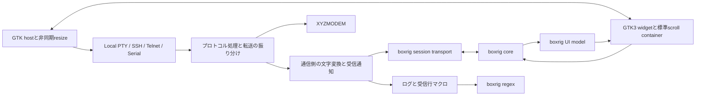

# boxrigへの端末基盤移行計画

## 目的と調査状況

elder-termsを、最初からboxrigで実装した端末アプリケーションとして再構成する。端末解析と画面状態を担うboxrig coreと、表示・入力を担うboxrig UIのGTK3版を使う。描画方針は`BOXRIG_GTK_RENDER_OPENGL_PREFERRED`とし、OpenGLを利用できない環境ではboxrigのCairo fallbackで動作を続ける。

boxrigは`deps/boxrig`のsubmoduleから、elder-termsの通常ビルド中に共有ライブラリとして生成する。移行後はlibvteへの参照と、elder-terms自身のPCRE2利用・直接依存を削除する。VTE型・signal・座標補正を再現する互換層や、旧backendへの切り替えは残さない。

調査対象のelder-terms実装は`9e71944da6d9a5f4f6b5f0a2d02ce7ccda7e17f8`。boxrigは2026年10月15日に取得した`origin/develop` HEAD、`4b664b87cf405dc97477a1403d8a987881a3134f`へ更新した。入れ子のsubmoduleも初期化済みである。直前の固定版は`19be168c464d0509c3388bdc7bb3bef4c2717d3d`、その前は`8ab9bdfe2c44c76b81d8d74899484350734fc86a`だった。最初の追加コミットは`f8b7aaa`、その時点の固定先は`5ebe6420f6f81b4bf38d11fe233285f470a83ae6`だった。

今回の再評価では、正規表現のUnicode一般カテゴリ対応を確認した。共通regex試験の`\p{L}`を含む式は、そのまま使用できる。既定HTTPルールも、カテゴリを明示すればUnicode空白で区切る動作を維持できる。照合前の名前検証、入力禁止、設定交換、端末由来のサイズ要求、PTY診断、共有ビルド、GTK3の本文アクセシビリティを含め、本計画で必須としたAPI不足は解消している。[API要件資料](boxrig-api-requirements.md)に対応状況、残る文法差、アプリの担当、受け入れ試験を記す。

今回はsubmoduleの更新と再調査・計画の改訂を行う。共有ビルドと上流のドライバーを実行した範囲は末尾に記録し、elder-termsへの移行実装・結合完了とは区別する。

本計画のUI modelは表示用モデル、GTK3 widgetはGTKへ配置する端末部品である。sessionは端末と通信路を結ぶ有限バッファ付きの処理単位を指す。host itemは端末からアプリへの通知、layout actionはアプリが反映する配置要求、revisionは要求や結果の世代番号である。

regexは正規表現を指す。コンパイル済みの式をprogram、一つの入力を検索する状態をmatcherと呼ぶ。captureは括弧で抽出する部分文字列、recognizerは画面の論理行を認識する仕組み、snapshotは特定時点の状態を保持するコピーである。DIPはDPIに依存しない論理的な寸法、metricsはboxrigが確定した文字の寸法情報を指す。

## 機能の対応と担当範囲

以下のIDはAPI要件資料と共通である。「既存API」はVTE互換を意味せず、boxrigの責任分担に従って実現できる項目を示す。

| 現行機能・利用箇所 | boxrigでの構成 | 方針 |
| --- | --- | --- |
| `VteTerminal`生成、`feed`、`commit` | core、UI model、GTK3 widget、sessionのdispatchと出力キュー | VTEの入出力signal中心の構造を廃止し、モデル更新とフレーム処理へ改める |
| ローカルPTYの生成、FD、行列数変更 | `spawn_with_diagnostic()`、`spawn_descriptor()`、`get_spawn_result()`、`resize()` | P1の不足は解消。同期準備と非同期診断・子監視をCardioへ接続する |
| 通常ウィンドウのサイズ変更、希望行列数、フォント変更 | preferred grid、layout action、font specification、visual zoom | 既存API。旧補正コードを丸ごと撤去する |
| 履歴容量、スクロール、選択、コピー、IME、mouse report、代替画面 | coreと標準GTK3 UI | 既存API。scroll containerもboxrigの標準を使う |
| 切断・転送・モーダル中の入力禁止 | GTK3の`set_input_enabled()`と`get_input_state()` | I1対応済み。停止段階とアプリ側の通信排出を区別する |
| Return、Backspace、TRS-80設定と接続中の変更 | `boxrig_input_config`とGTK3の`set_input_config()` | K1対応済み。保留入力による`BUSY`を扱い、旧キー補正を撤去する |
| Kitty keyboardの特殊キー補完 | coreのキー生成 | 既存API。アプリのKittyパーサーとcommit補正を削除する |
| iconvの任意文字コード | UTF-8のcoreと通信側の文字変換 | アプリ機能として分離する。キー列を書き換える機能を持たせない |
| OSC 8取得と画面リンクの認識 | hit test、共有programのrecognizer登録、保持済みcapture、annotation | R1・R2の照合機能は対応済み。候補の再照合を廃止する |
| マクロ、ルール検証、番号・名前付きテンプレート | 独立regex・capture・programの名前照会とアプリの受信行／実行管理 | R1・R2対応済み。照合前の保存時検証も公開APIへ接続する |
| 色、接続背景、タイトル、ベル | color filter、background、TITLE／BELL host item | 色の適用規則、タイトル合成、音声再生はアプリが接続する |
| メニュー・中クリック等からの速度指定付き貼り付け | router、GTK clipboard、アプリの送信サービス | 選択コピーは標準UIを使い、送信ポリシーはアプリに残す |
| `resize-window`で受ける端末側の要求 | `BOXRIG_HOST_ITEM_GRID_RESIZE`からpreferred gridへ | W1対応済み。許可・上限・0／省略の意味をアプリで扱う |
| Linux共有ライブラリ、C++リンク | 上流の`shared-gtk3`と公開C ABI | B1対応済み。5本の共有ライブラリを親ビルドから生成する |
| 読み上げ・本文アクセシビリティ | GTK3 widgetのAtkText | A1対応済み。表示本文と通知をアプリのfocus・overlayを含めて検証する |

調査元は[起動処理](https://github.com/kekyo/elder-terms/blob/9e71944da6d9a5f4f6b5f0a2d02ce7ccda7e17f8/elder-terms-vte/src/main.cpp)、[ウィンドウ](https://github.com/kekyo/elder-terms/blob/9e71944da6d9a5f4f6b5f0a2d02ce7ccda7e17f8/elder-terms-vte/src/main-window.cpp)、[レイアウト](https://github.com/kekyo/elder-terms/blob/9e71944da6d9a5f4f6b5f0a2d02ce7ccda7e17f8/elder-terms-vte/src/terminal-layout.cpp)、[TerminalViewIo](https://github.com/kekyo/elder-terms/blob/9e71944da6d9a5f4f6b5f0a2d02ce7ccda7e17f8/elder-terms-vte/src/terminal-sessions/terminal-view-io.cpp)、[共通regex](../../../shared/src/settings/regular-expression.cpp)である。上流は[GTKガイド][gtk-guide]、[GTK3公開ヘッダー][gtk-api]、[core公開ヘッダー][core-api]を基準にする。

## boxrigを前提とする構造

### 所有権と責任

アプリに端末runtimeを設け、core、model、GTK3 widgetへの接続、接続世代、フレーム予約を管理する。GTKコンテナーがwidgetを所有し、widgetはmodelとcoreを借用する。通信方式ごとのオブジェクトはGtkWidgetやVTE互換インターフェイスを持たず、受信・送信・resize・終了を提供する通信機能へ分離する。

既存の通信実装、SSH認証、Telnet制御列、シリアル操作、BREAK、XYZMODEMは再利用できる。`TerminalViewIo`を残して関数名だけ差し替える移行は行わない。再利用するのは表示と独立した処理に限り、所有権と呼び出し境界を改める。新しい境界は関数表と状態の組み合わせを基本にし、backendクラスの継承階層を増やさない。

通信を切断・再接続しても、表示と履歴を所有するcoreは維持する。接続ごとのsessionとキューを終了させ、次の接続世代へ古い入力やコールバックを渡さない。終了時は新規要求を止め、Cardioタスクとフレーム予約を切り離し、widgetをquiesce・破棄してからmodelとcoreを解放する。sessionは借用するcoreとtransportより先に破棄する。

### 受信と送信

boxrigの[session API][session-api]を基本にし、Cardioの非同期処理が用意したキューを非ブロッキングtransport callbackへ接続する。callback内では待機しない。準備できないときは`WOULD_BLOCK`を返し、実際に準備ができた通知からdispatchを予約する。FDを直接sessionへ渡すことだけを組み込み方法としない。

通常受信をプロトコルと転送処理から分離し、文字変換前をrawログ、変換後をcookedログとマクロへ一度通知する。coreへ渡すUTF-8列はsessionの有限バッファで保持し、部分消費や再試行で変換・通知を繰り返さない。XYZMODEMのバイナリをcoreやregexへ投入しない。

送信もアプリ所有の有限キューで受理した量だけを報告する。coreの借用バッファを非同期処理へ持ち越さない。端末応答と利用者入力の順序、送信中止、転送開始、再接続を同じ通信サービスで管理する。キュー満杯で読み込みを待機させる機構を設け、無制限に蓄積しない。

任意encodingはアプリのiconv変換として維持する。coreはUTF-8を使い、内蔵Shift_JISと二重変換しない。変換器からはTRS-80変換とキー補正を削除する。EOFでは変換器の末尾を一度排出してからCLOSEDを返す。その後もsessionを進め、coreへの`finish_input()`が完了して`peer_closed`が通知されるまで処理する。

### フレームとホスト要求

`frame_request_callback`はGLib main contextへ処理を予約するだけにする。処理時にsession、host queue、認識器、layout actionを有限量ずつ進め、modelをsynchronizeしてwidgetのframeを呼ぶ。GTKのdrawやboxrigのcallbackから通信・frameを再帰的に呼ばない。

`additional_dispatch`なら追加処理を予約し、`frame_pending`だけでidleを回し続けない。通信の準備、GTKの割当・描画、入力など、進展に必要な通知を待つ。GTK版がmain contextへ接続するアニメーション機構を使い、描画を進めるための固定周期pollingを作らない。[GTKのframe契約][gtk-api]と[点滅の接続][blinking-guide]に従う。

TITLEとBELLはアプリのタイトル合成と音声再生へ接続する。payloadは借用期間中にコピーする。未対応のhost requestもconsumeし、request IDがある場合は拒否・利用不可を一度返して出力の順序待ちを解消する。OSC 52、通知、外部画像データを利用者向けに新規提供することは、本移行の必須範囲に含めない。[ホスト要求の契約][host-guide]を参照する。

### 入力設定・停止・起動の境界

入力設定は`boxrig_input_config`から構築し、GTK3の`set_input_config()`で一括交換する。押下中のキー、IME、clipboard、pasteが残る場合の`BUSY`では旧設定を保持し、入力処理を進めて再試行する。ReturnとTRS-80はcoreの設定へ渡し、BackspaceのAutoはboxrigの規則へ従う。明示BS／DELもcoreへ渡す。TTY bindingを提供する場合だけ、キー処理直前に公開POSIX APIで消去文字を取得・反映し、接続変更時に消す。[送受信ガイド][io-guide]を参照する。

入力禁止は`set_input_enabled(false)`と`get_input_state()`を使う。`STOPPING`は停止を受理し、paste終端の投入を待つ状態である。`DISABLED`でもcoreと通信側に出力が残り得るため、アプリの送信runnerを止め、通常出力を排出してから転送を開始する。入力callback内の`BUSY`は要求未受理なので、状態を確認して呼び直す。接続世代はwidgetの入力世代と別に持ち、古いアプリ送信・clipboard応答を再接続へ渡さない。[GTK3の契約][gtk-api]に従う。

転送中は通常sessionのwrite callbackを`WOULD_BLOCK`で保留し、XYZMODEMだけを専用の送信経路へ通す。入力禁止後も生成され得る端末応答を転送データへ混ぜない。同じ接続での転送完了を通知した時点で通常送信を再開し、切断した場合は旧出力を破棄する。再開待ちは通知で進める。

PTY起動は`boxrig_posix_pty_spawn_with_diagnostic()`を使う。同期の親側準備はCardioの`promises::start_new()`で隔離し、返された診断FDを非同期に待って`get_spawn_result()`を呼ぶ。FDは借用し、直接read・closeしない。子回収を一つの経路へ集約し、取消要求後も回収完了まで所有者を残す。起動失敗のstage・errnoと、正常起動後の終了127を区別する。[sessionガイド][session-guide]と[起動ドライバー][spawn-example]を基準にする。

IMEは`BOXRIG_GTK_IME_AUTO`でGTK委譲・IBus・fcitx 5／4の選択をboxrigへ任せる。`get_ime_state()`の経路と診断を記録し、アプリ独自のIMEやキー状態解析を追加しない。AtkTextも標準widgetへ任せ、focusとoverlayを含む本文・caret・選択・通知を検証する。[IMEガイド][ime-guide]と[GTKガイド][gtk-guide]を参照する。

## サイズとフォントを管理する唯一の経路

### 通常の操作

初期行列数と明示的な変更は`set_preferred_grid()`、window stateは`set_window_state()`へ渡す。希望gridと実際のallocationを分け、core・通信先の行列数はlayout actionの完了を基準に確定する。geometry hintsは`set_geometry_hints()`へ任せ、hintsが無視されても正しく動く構成にする。

font familyと直接指定した文字サイズには`set_font_specification()`を使う。ズームキーとCtrl+wheelは`visual_zoom()`へ渡し、boxrigの視覚的な段階を利用する。標準のvisual step policyを基本とし、VTEの倍率0.5〜3.0と0.1刻みへ合わせる計算を廃止する。複数のズーム要求とpresentation待ちはboxrigに管理させる。[フォントと配置][font-guide]、[visual zoomのAPIコメント][gtk-font-api]が根拠である。

設定は倍率からDIPの文字サイズへ改める。初期値は`boxrig_font_specification_default()`に基づき、保存時には確定したeffective metricsの`requested_size_dip`を使う。visual zoomがraw font specificationを書き換えない点に注意し、raw getterから現在の表示サイズを推測しない。次回は保存DIPをfont specificationへ指定する。DPIとGTK backing scaleを二重適用せず、物理セル寸法そのものは保存しない。

サイズの保存通知は確定したlayout revisionから行い、最大化中の一時的なgridで通常状態の希望gridを上書きしない。スムーズホイールを操作回数へ変換する入力処理はアプリに置けるが、フォント適用をタイマーで遅らせたり、旧gridへ押し戻したりしない。APIが`BUSY`を返す場合は状態変化の通知から未受理操作を再試行し、成功済み操作を二重適用しない。

### hostが担当するlayout action

`take_layout_action()`で実行可能な要求を一件取り出す。content-size要求は出力pixelの26.6固定小数からGTK論理pixelへ換算し、実際の兄弟widgetの占有分を加えてトップレベルへ伝える。GTKが処理するCSDの高さや枠を重ねて加算しない。子へのallocation後に、要求と同じrevisionを`complete_size_command()`へ返す。

要求どおりの寸法にならない場合も、実際の割当とaccepted／constrained／rejected／supersededを返す。希望寸法に一致するまで待つループや、configure-eventだけで完了する処理は作らない。最大化解除の通知と実際の通常allocationにずれがある場合も、イベントとrevisionで処理する。hostの接続方法は[GTKサンプルのnative host][native-host]を参考にする。

grid-resize要求は通信先へ反映してからcoreをresizeし、同じrevisionを`complete_grid_resize()`で完了する。ローカルは`boxrig_session_resize()`を使える。SSHなどの非同期系ではアプリが通信処理をawaitし、その後coreへ反映する。この場合sessionへ同期resize callbackを登録せず、同じサイズを二重送信しない。未接続の間はcoreだけをresizeして完了し、次の接続はその確定gridから開始する。

通信側の`resize()`がvoidの現構造を改め、失敗・中止を完了へ反映する。boxrigでは失敗完了によりwidgetがquiesceされるため、表示を保持したまま接続を終了し、再開には必要なUI接続を再生成する。後のallocationは別revisionとして残し、古い完了で消さない。[layout actionの契約][gtk-layout-api]に従う。

スクロールバーは`create_scroll_container()`と`set_scrollbar_visibility()`で管理する。標準コンテナーのpolicyを直接書き換えない。バーの幅、フォント変更、最大化、コンパクト表示によるallocationを、すべて同じlayout actionへ集約する。

端末からの`BOXRIG_HOST_ITEM_GRID_RESIZE`は各軸の`EXPLICIT`／`KEEP`／`DISPLAY`を解釈し、通常ウィンドウで許可した要求だけpreferred gridへ渡す。0は表示領域、省略は現在値であり、同一視しない。最大化・タイル中や上限外の要求は消費して拒否する。request IDは0なのでhost requestへの完了応答は不要で、採用後のlayout actionだけを通常どおり完了する。[ホスト要求の契約][host-guide]に従う。

### 削除する既存コード

以下は[terminal-layout.cpp](https://github.com/kekyo/elder-terms/blob/9e71944da6d9a5f4f6b5f0a2d02ce7ccda7e17f8/elder-terms-vte/src/terminal-layout.cpp)と関連コードから削除する対象である。新しい名前で同じ補正を再実装しない。

| 撤去対象 | boxrigでの扱い |
| --- | --- |
| `font_zoom_apply_timeout_ms`の16 ms、`font_resize_guard_timeout_ms`の50 ms、`window_size_sync_debounce_ms`の200 msと各source | フレーム要求、layout action、revisionと実allocationで進める |
| `font_resize_guard_active`、`font_zoom_anchor_active`、`font_zoom_pending`、`layout_grid_guard_active`、保留倍率・復元用行列数 | visual zoomとlayoutの希望値・進行中世代をboxrigが保持する |
| `terminal_grid_is_locked()`、`ensure_terminal_grid_size()`、旧gridの強制再設定 | 正式にdispatchされたgrid要求だけをcoreと通信先へ反映する |
| `resize_window_to_hinted_grid()`、`hinted_cell_count()`、`window_size_matches_hinted_grid()`、`sync_window_size()`内の再補正 | 実allocationからboxrigがgridを決める。端数を低レベルresizeで押し戻さない |
| `update_geometry()`のVTEセル幅・style padding・CSD・hints計算、`old_char_*`等のキャッシュ | effective metricsとgeometry helperを使う。hostには座標単位の換算と兄弟領域の実寸だけを残す |
| `notify::font-desc`、`font-scale`、`cell-width-scale`、`cell-height-scale`への補正接続 | font APIと確定layout／metricsを使う |
| 外部scrollbar用VTE adjustment接続 | boxrig標準scroll containerを使う |
| `TerminalViewIo`のcommit、Return保留、修飾特殊キー補完、idle clear | core入力policyとGTK3 UIを使う |
| `TerminalKeyboardProtocolState`、`TerminalCursorKeyMapper` | Kitty状態とTRS-80 mappingをcoreへ集約する |
| VTEの実行時デフォルトfont scale取得、PangoFontDescriptionのVTE向け合成 | boxrigのfont specificationと設定DIPを使う |

レイアウト試験も、固定倍率1.1、VTEのcell hints、低レベル強制resizeを正解とする前提を改める。文字の安定、希望gridの保持、制約されたwindowの表示、通信先との一致を検証する。ズーム中にgridが不要に往復しないことは動画とPTY通知の時系列で確認する。

## 正規表現と共通設定の接続

画面のregexリンクはboxrigのtext recognizerへ登録し、有限量ずつ走査する。認識IDをアプリのルール順へ対応させ、hitに重なる現在の結果から候補を選ぶ。annotation、ポインター表示、Ctrl+クリックは同じ結果を使い、古いrevision・`INCOMPLETE`・`RESCAN_REQUIRED`を完全な結果として利用しない。[認識器の仕様][text-guide]に従う。

OSC 8 URI、受信行マクロ、設定検証は公開`boxrig/regex.h`へ統一する。不変programをmatcherと画面recognizerで共用し、画面では`boxrig_terminal_text_recognizer_result()`から保持済みcaptureを取得する。全体一致は入力の絶対バイト位置、captureは結果本文からの相対位置なので混同しない。結果は使用後に破棄する。`${...}`展開、URI decode、コマンド起動、絶対ローカルパスの検証はアプリが行う。[regexガイド][regex-guide]と[公開API][regex-api]を参照する。

マクロは制御列を含むUTF-8受信行を対象とする。現在の行、CRLFの扱い、LF前の実行、優先順、一行一度の実行、1 MiB上限はアプリが管理する。matcherは入力をコピーするので、受信が進んでも照合中のsnapshotを保持できる。未処理の受信通知を最新行だけにまとめて途中の一致を落とさず、有限キューと接続世代で管理する。生成時の入力検証・コピーは同期であり、resumeの仕事量制限とは別に入力長を制限する。既定VS CodeリンクとREADMEのcapture付きマクロは現在のAPIで実現できる。

PCRE2の全構文互換は求めず、boxrigの最左最長と限定文法を採用する。番号・名前付きcaptureと`(?:...)`は対応済みである。先読み・後読み・後方参照・遅延量指定は使えず、空一致は全用途で禁止する。`\d`・`\s`・`\w`がASCII限定である点、`.`がLFを含む点、anchorの対象、一致の選択規則を設定説明とテストへ反映する。ESCは`\u{1b}`で記述する。既存設定を黙って変換せず、構文とバイト位置の診断を表示する。

`\p{L}`などのUnicode一般カテゴリは対応済みとなった。一般カテゴリは文字・結合符号・数などの分類を指し、略称を大文字・小文字を区別して波括弧で囲む。`\P{L}`による否定と文字クラス内の指定も利用できる。共通regex試験の日本語hostの式は変更せず、名前付きcaptureとUTF-8バイト位置の検証を残す。文字体系や一般カテゴリ以外の属性は未対応である。分類のためのアプリ独自のUnicode表や別エンジンは追加しない。

既定HTTPの2ルールでは、否定クラス内の`\s`を`\s\p{Z}\u{85}\u{180e}`へ改め、全角スペースを含む従来の区切りを維持する。現在のアプリと更新版boxrigで26種類の区切りを比較し、画面リンクの終端とOSC 8の拒否結果が一致することを確認した。具体的な式と根拠は[API要件資料のUnicode一般カテゴリ](boxrig-api-requirements.md#unicode一般カテゴリと既定リンク)に記す。変更するのは製品が用意する既定式であり、利用者設定の自動変換は行わない。

一般カテゴリ対応後も、一致全体は書記素境界に限られる。例えば`e`と結合アクセントの全体には`\p{L}+`だけでは一致せず、必要な用途では`[\p{L}\p{M}]+`と記述する。アプリが結合符号を暗黙に追加する補正は作らず、[regexガイド][regex-guide]と[公開コメント][regex-api]の一致規則を案内する。

設定保存時の名前検証には、追加済みの`boxrig_regex_program_find_named_group()`を使う。成功時も`found`を確認し、存在しない`${missing}`を拒否する。番号は桁あふれを検査して0から`group_count()`までを受理する。optional groupや`{0}`内の名前は存在し、一致時の参加有無とは分けて扱う。NULを含む参照名はC文字列へ変換する前に拒否する。これらは照合や端末生成を必要としない。[regexガイド][regex-guide]と[APIコメント][regex-api]の契約に従う。

共通regexの結果はboxrigの不変resultを所有し、番号・名前によるcapture取得を委譲する。既存の名前一覧mapと文字列配列は廃止し、列挙APIを追加で要求しない。定義済みだが未参加のgroupは空文字へ展開し、未知の参照はエラーにする。テンプレート構文・URI decode・コマンド用途はアプリに残す。上流API待ちの工程はなくなり、照合・展開と保存時検証を同じ段階で完成できる。

## OpenGL Preferredの構成と検証

GTK3 widgetのconfigへ`BOXRIG_GTK_RENDER_OPENGL_PREFERRED`を明示する。boxrigの既定値はCairoなので、GTK3をリンクするだけではこの設定にならない。上流Makeには`GTK_OPENGL=1`を指定する。コンパイル定義の`BOXRIG_GTK_OPENGL=1`はMakeが設定する。GL context、描画先、fallbackはboxrigに任せる。[render policyの定義][rendering-api]と[Makefile][upstream-make]を参照する。

生成成功時にはまだbackendがNONEの場合がある。realize後にフレームを進め、`get_render_state()`で実backendと`pending=false`を確認する。GL利用可能な環境ではOPENGL、GL利用不可の環境ではCAIROへのfallbackと継続描画を検証する。fallback理由は診断ログで取得し、GLが使えないだけで起動を失敗させない。

PreferredでもGLを除いたビルドを通常成果物にはしない。`NOT_BUILT`による恒常的なCairo表示をGL対応の検証成功としない。context喪失時もframeと診断を処理し、backend変更後の選択・IME・overlay・サイズ変更を確認する。

OpenGL 3.3 coreまたはOpenGL ES 3.0の描画経路と、Cairo fallbackの双方を対象にする。MesaのソフトウェアGLは自動試験に使い、実GPUの確認も別途行う。GLでも文字描画用のPango/Cairo依存は残る。[描画方式][renderers-guide]を参照する。

## 共有ライブラリと配布

### ビルド構成

現在のMake → npm workspaces → Meson/Ninjaを入口として維持する。boxrigは上流の`shared-gtk3`／`install-shared-gtk3`を呼んで構築する。[ビルドガイド][building-guide]と[共有Make定義][shared-make]に公開された構成であり、独自のソース列挙・単一共有ライブラリ・C ABI用bridge案は廃止する。

親の準備処理で初回とlockfile更新時に`npm ci --prefix deps/boxrig/tools/codegen`を実行し、上流Makeへ絶対パスの`BUILD_DIR`、`GTK_OPENGL=1`、固定版の`BOXRIG_VERSION`を渡す。生成物は`.build/boxrig/`配下に集める。SDKを私有のstaging先へインストールし、生成された`.pc`をMesonから利用する。`.pc`には版だけが入るため、追跡する正確なコミットはgitlinkと親側の更新記録で保持する。

成果物は`libboxrig.so.0`、`libboxrig-ui.so.0`、`libboxrig-session.so.0`、`libboxrig-posix.so.0`、`libboxrig-gtk3.so.0`の5本と開発用リンク名である。`shared`のregexはcoreだけを利用し、端末はGTK3・UI・session・POSIXを加える。上流Makeが同梱codecをPICで組み込み、公開symbol・専用symbol・SONAME・`$ORIGIN`を管理する。`BOXRIG_PRIVATE_0`をアプリから参照せず、静的archiveやOpenGL objectを重ねてリンクしない。

最初のMeson設定前にSDKとpkg-config情報を用意する。その後もNinjaから上流Makeへ更新確認が到達するcustom targetを設け、利用側へ生成物と順序の依存を明示する。source・header・flagsは上流Makeの依存関係へ任せ、gitlinkとcodegen依存の変更は親側でも追跡する。`make`、個別workspace、Mesonからの増分ビルドで、古い共有ライブラリを使わないことを確認する。未初期化なら`git submodule update --init --recursive`を案内する。

SDKへのインストールは、ライブラリ・header・metadataが変わったときに行う。同一内容の再コピーだけで更新時刻を進め、アプリ全体を再リンクしないようにする。上流の共有ビルドが増分動作することと、親のstaging処理が不要な更新を起こさないことを別々に検証する。

Node.js・Vite・funcityによるmetadataとライセンス生成も上流のtargetを使う。codegenの`node_modules`は依存導入先に置けるが、外部の追跡対象ファイルは変更せず、コンパイル・生成出力は親ビルド領域へ置く。Make読込時には他platformのpkg-configも照会されることが[ビルドガイド][building-guide]に記されている。段階1でGTK3に必要な依存だけを入れた環境を使い、対象外の不足診断が出る場合は上流で依存照会をtargetに絞る改善を検討する。不要なplatformのソースを親で独自ビルドする回避策へは戻らない。

公開ヘッダーをC++20から通常includeする。boxrigの5共有ライブラリはCardio runtimeを組み込まないため、PTY起動のCardio接続はelder-terms側で実装する。boxrig内のCardio submoduleを別runtimeとしてリンクせず、アプリとlibxyzmは現行の共有`libcardio.so`を使う。

ホストGCC、C99/C++20、warnings-as-errorsを使う。上流由来の警告抑制は対象と理由を確認し、新規アプリコードへ無差別に広げない。GTK4、native X11／Waylandの別component、Windowsサンプルはビルド対象へ加えない。

### 依存パッケージとインストール

GTK3 3.24以上、Pango 1.50以上、Cairo 1.18以上、IBus 1.5.29以上、Wayland client 1.22以上を基準にする。PangoCairo、PangoFT2、Fontconfig、libepoxy、GL／EGL開発環境も必要になる。[上流pkg-config][gtk-pkgconfig]とMakefileを照合して依存を確定する。

直接fcitx 5／4はGLib／GIOで接続するため、fcitx開発パッケージは追加しない。実行時のデーモン・入力エンジンやGTKモジュールは利用するIMEに応じて必要である。GUIを初期化しないregex検証には、これらの稼働を要求しない。

`prereq.sh`、コンテナ内ビルド、README、パッケージ試験から`libvte-2.91-dev`と明示的な`libpcre2-dev`を削除し、必要な描画依存を加える。候補は`libcairo2-dev`、`libpango1.0-dev`、`libfontconfig1-dev`、`libepoxy-dev`、`libibus-1.0-dev`、`libwayland-dev`、`libgl-dev`、`libegl-dev`である。

bookworm標準の[Cairo 1.16.0](https://packages.debian.org/bookworm/libcairo2-dev)と[IBus 1.5.27](https://packages.debian.org/bookworm/libibus-1.0-dev)は要求に届かない。後方互換性を求めない方針から、本計画ではbookwormの4構成を対象から外す。Debian trixieの5構成とUbuntu 24.04／26.04の各2構成、合計9件を候補とし、配布段階で全件を検証する。対象変更は利用者向けに明記する。

共有5本は既存の私有libdirである`lib/elder-terms/`へ同梱する。子実行ファイルの`$ORIGIN/..`と`libelder-terms.so`の`$ORIGIN`を設定し、上流の共有ライブラリ自身が持つ`$ORIGIN`と接続する。`dpkg-shlibdeps`には5本すべてを入力し、stagingと移動後のインストール先からロードを確認する。build pathや`LD_LIBRARY_PATH`に依存した起動を完了としない。

boxrigと組み込むcodec、Unicode・encodingデータのライセンスを[上流の配布条件][distribution-guide]に従って同梱する。PCRE2についてはアプリ・同梱boxrigの直接依存を除去するが、GTK/GLib自体の間接依存を消したとは主張しない。調査環境のGLibはPCRE2を必要としており、詳細は[API要件資料](boxrig-api-requirements.md)に記録した。

## インクリメンタルな実装手順

各段階は、それ以前の成果物をビルド・実行できる状態で進める。先に外から観測できる機能のテストを追加してREDを確認し、実装後にGREENと完了条件を照合する。段階ごとに`feat:`、`refactor:`、`chore:`、`doc:`等のコミットを作る。上流側の作業はこのcheckout内では実施せず、公開コミットを受け取ってから進める。

### 段階0 調査とsubmodule固定

submoduleを追加・初期化し、本計画とAPI要件資料を保存する。今回はdevelop HEADへ更新し、Unicode一般カテゴリの追加と既存APIへの影響を確認する。共通regex試験の元の式を維持し、既定リンクのUnicode空白の区切りを実現できるかも調べる。完了条件は、固定した上流ソースが無変更であること、利用箇所とAPIの根拠を追えること、PCRE2廃止・旧レイアウト撤去・Preferredが一貫した計画になっていることである。段階1以降は追加APIの公開を待たずに進められる。

### 段階1 共有ライブラリとGTK3実行ドライバー

Make・Mesonの接続を作り、固定出力を表示するドライバーを通常ビルドへ追加する。core・model・widgetと標準scroll containerを生成し、frame、host item、layout actionを処理する。最初から新しいレイアウト経路だけを使い、旧terminal-layoutを共有しない。

REDはドライバーの表示と共有ライブラリのロードで確認する。GREENでは日本語・属性・選択・コピー・履歴・window resize・visual zoomを観測し、OpenGL成功とCairo fallbackの両方を通す。PNGを使う既存GTK処理との共存、C++リンク、クリーン・増分ビルドも検証する。

完了条件は、submoduleを汚さず通常ビルドから共有ライブラリとドライバーが生成され、表示とレイアウトを操作できること。コミット例は`feat: build boxrig shared runtime and GTK3 driver`。

### 段階2 ローカルPTYと非同期runtime

Cardio transport、boxrig session、接続世代、raw／cooked通知、EOF、終了処理を接続する。ドライバーからローカルシェルを操作可能にし、layout actionをPTYへ反映する。公開済みのP1を使い、親準備・起動診断・子終了を分けて表示する。

REDは入出力、端末応答、PTY grid、起動失敗、閉鎖を外から観測する試験で作る。GREENで部分送受信、queue満杯、EOF末尾、連続resize、再接続、起動取消、正常終了127との区別、子回収を通す。画像だけで通信成功を判定しない。

完了条件は、ローカル対話と再接続ができ、データの欠落・二重通知・残存子プロセスがないこと。P1のstage・errnoを表示し、取消の後始末が完了すること。コミット例は`feat: connect boxrig runtime to local PTY`。

### 段階3 入力policyと全通信方式

公開済みのI1・K1・W1を使い、SSH、Telnet、シリアルをドライバーから利用可能にする。設定交換、TRS-80 mapping、入力禁止、速度指定の送信、ログ、転送分岐、非同期resizeを接続する。A1の本文・caret・選択・通知をドライバーで観測し、IME AUTOでGTK委譲・IBus・fcitxの動作を確認する。regexを使うリンクとマクロは段階4で追加する。

REDは相手に届くバイト、ログ、保留IME、転送中の入力、端末側サイズ要求で作る。GREENでは4通信方式、設定の実行中変更、Kitty、再接続、BREAK、XYZMODEM、SSH proxyとSFTP共有を通す。`STOPPING`からの停止完了と通信キューの排出、遅い端末応答が転送へ混入しないこと、通常送信の再開を確認する。通信先のresize失敗を成功通知で隠さない。

完了条件は、ドライバーで4通信方式と入力・ログ・転送を操作でき、端末状態を再生成せず設定交換できること。サイズ変更と入力禁止に旧補正を持ち込まないこと。コミット例は`feat: integrate boxrig input policies and terminal transports`。

### 段階4 boxrig regexと共通設定

前半では現在のAPIで、GUIなしの照合・captureドライバーと、画面リンク・OSC 8・受信マクロを追加する。既定VS Code URI、番号・名前付きマクロ、制御列、複数リンク、古いrevisionをREDからGREENへ進める。既定HTTPルールのUnicode空白を明示し、画面リンクの終端とOSC 8の全体照合を検証する。この成果物だけで照合と展開を観測できる。

後半では、取り込み済みの名前照会APIを使って`shared`とlauncherのregex・テンプレート検証を切り替える。`${path}`を保存でき、`${missing}`を照合前に拒否できる試験を先にREDにする。optional group、数字の0・最大番号・桁あふれ、大小文字、NULを含む参照名を検証する。文法エラー・容量超過・バイト位置、空一致拒否、UnicodeとLFの意味差も対象とする。前半のドライバーを動かせる状態で保存時検証を接続し、追加の上流更新は前提にしない。

Unicodeの受け入れ試験では、共通regex試験の`\p{L}`を含む式・日本語host・capture・バイト位置を維持する。全角スペースや絵文字でhostのcaptureが止まること、否定と和集合、結合符号、`\d`と`\p{Nd}`の範囲差、不正なカテゴリ名と診断位置、仕事量1での再開も含める。独立matcherと画面recognizerの結果を比較し、設定画面の保存・再読込でも同じ文法を使う。

完了条件は、boxrig経路のregexが一つのエンジンへ統一され、既定リンク・受信マクロ・テンプレートと保存時検証が動くこと。Unicode分類と元のcapture試験を維持し、既定HTTPルールがUnicode空白を取り込まないこと。名前表の独自解析や重複保持を残さず、本体切り替えの前提条件にする。移行前のVTE本体がまだ必要とする依存は一時的なものとして区別し、新経路へPCRE2を追加しない。前半・後半を意味のある単位でコミットする。例は`feat: use boxrig regex for terminal actions`と`feat: validate rule captures with boxrig metadata`。

### 段階5 本体UI切り替えと旧構造の撤去

GtkBuilderにboxrigの配置先を設け、認証・接続通知・dim overlay・メニューを接続する。新runtimeを本体へ導入し、既存の`terminal-layout.cpp`、`TerminalViewIo`、キー補正の責任を終了させる。レイアウトの旧タイマー、signal接続、補助関数、キャッシュ、VTE倍率設定をこの段階で削除する。

旧経路の除去確認は、両経路の再補正や入力重複が起きない操作試験を先にREDにし、撤去後のGREENを確認してコミットする。名称の検索だけを除去試験にしない。一時的な除去確認テストはその後の別`chore:`コミットで削除し、通常の機能・回帰試験を残す。

文字サイズDIPの保存、画面制約、バー表示、コンパクト表示、色、タイトル、ベル、コピー、リンク、貼り付けを確認する。画像masterの更新時は目視し、連続ズームやresizeは動画とgrid通知を検証する。

完了条件は、本体がboxrigで動作し、撤去表の処理が新経路と競合しないこと。旧VTE backendへのfallbackを持たず、利用者の操作がドライバーと同じ契約で動くこと。コミット例は`refactor: replace terminal UI with boxrig runtime`。

### 段階6 参照・依存・名称・配布の整理

`elder-terms-vte`のディレクトリ、workspace、実行ファイルを`elder-terms-terminal`へ改名する。launcher、`ELDER_TERMS_VTE_PATH`等の環境変数、desktop ID、WM class、配置先、テスト名を更新する。旧名aliasは作らない。

libvteの型、ヘッダー、関数、signal、version分岐、pkg-config・リンク・配布依存を削除する。残ったPCRE2呼び出し、オプション定数、直接依存、開発パッケージも取り除く。共通regexの旧公開型が不要なら整理し、キャプチャテンプレートなど製品機能はboxrigの結果を使う形で残す。

日本語READMEを原本として操作・設定・文法・依存・対応環境を更新し、英語へ反映する。現存コードへのリンクも改名に合わせる。過去の計画やGit履歴にある比較・移行記録は稼働依存と区別し、現在の利用案内に旧backendの前提を残さない。

共有ライブラリ、RUNPATH、`dpkg-shlibdeps`、ライセンス、bookworm除外を配布処理へ反映する。対象9件のクリーンな環境でビルド・インストール・通常起動を行い、libvteを入れずにlauncher、端末、転送画面が動くことを確認する。

完了条件は、稼働コードと配布から旧依存が消え、同梱boxrigを実際にロードし、全体テストと全配布対象の検証に成功すること。除去確認と一時テスト削除は前段と同じ手順でコミットする。

## 検証範囲

| 領域 | 観測する結果 |
| --- | --- |
| 描画 | GL成功、Cairo fallback、context喪失、文字・色・選択・IME・overlayの継続表示 |
| レイアウト | 初期grid、連続resizeとzoom、最大化・タイル復帰、DPI、バー表示、拒否・古いrevision、PTY通知の順序 |
| 通信 | Local／SSH／Telnet／Serial、部分I/O、EOF、再接続、queue上限、DSR応答、resize失敗 |
| 入力 | Autoと明示コード、Kittyとkeypad、TRS-80、IME、入力禁止中の選択コピー、保留入力の破棄 |
| regex | 既定リンク、番号・名前付きcapture、受信マクロ、設定検証、複数一致、折り返し、Unicode、資源上限、文法変更 |
| 製品機能 | ログ、速度指定の送信と中止、BREAK、XYZMODEM、SSH proxy、SFTP共有、FTP／FTPS／WebDAVの起動 |
| 配布 | PIC、SONAME、symbol衝突、C++ ABI、増分ビルド、private RUNPATH、共有実ロード、直接依存の除去 |

GTK操作は既存のgestament環境を使う。試験の待機は状態・イベント・revisionを基準とし、実装の固定sleepで成功させない。アプリがGTKへ渡す通常のhost処理までなくすことと、旧ハックの撤去を混同しない。

完了時は`npm test --workspaces`を必ず実行する。端末workspaceが呼ぶMesonのC++試験と、各workspaceのVitestを含む。改名後も同じ入口で全体が動くようにする。個別試験だけで移行を完了扱いにしない。

## 最終完了条件

| 条件 | 確認方法 |
| --- | --- |
| boxrigと入れ子submoduleが公開コミットに固定され、外部コードが無変更 | gitlinkと各作業ツリーの確認 |
| 通常ビルドで共有boxrigを生成し、配布先から使用する | クリーン・増分ビルド、インストール先での実ロード |
| GTK3でOpenGL Preferredが機能する | GLとCairo fallbackそれぞれの実render stateと継続操作 |
| 必須APIの不足を解決し、機能差の扱いが明示されている | R2の名前照会を含む設定検証、R1・I1・K1・W1・P1・A1の結合試験 |
| regexがboxrigへ統一され、PCRE2のアプリ利用・直接依存がない | 全用途の機能試験、直接リンク・symbol・パッケージ監査。システムGLibの間接依存は区別 |
| サイズとフォントはboxrigのAPIと一つのlayout経路で動く | 撤去表との照合、時系列のUI・PTY試験、旧補正の残存監査 |
| libvteへの稼働参照、依存、旧backendがない | libvteなしの起動、依存監査、ソース・設定・配布検索 |
| 4通信方式と製品機能が動作する | 検証表を操作・表示・通信結果で確認 |
| 不要コードと一時除去テストを整理した | 段階ごとのコミットと最終コードの確認 |
| 全体テストと対象9件の配布試験が完了した | 実行結果、画像の目視、必要な動画アサートの記録 |

## 移行実装の記録

### 段階1の実装（2026年10月15日）

通常ビルドから共有ライブラリ5本とGTK3ドライバーを生成する経路を追加した。`make`と各workspaceのビルドは既存の入口を使い、Mesonの初回設定でもSDKを準備する。生成先は`.build/boxrig/`で、上流の追跡対象ファイルは変更していない。

ドライバーは`.build/elder-terms-vte/boxrig-driver`で起動できる。日本語、緑色の太字、選択コピー、履歴、ウィンドウのリサイズ、visual zoomを操作できる。表示にはcore、UI model、GTK3 widget、標準scroll containerを使い、マウスの選択操作は[公開の選択API][text-guide]へ接続した。

gestamentの試験は実装前に3件とも失敗し、実装後に成功した。MesaでOpenGL描画を確認し、`GDK_GL=disable`ではコンテキストを生成できない診断とCairoでの継続操作を確認した。表示本文だけでなく、描画された緑色の文字も検証した。両経路の画像を目視し、日本語、色、選択範囲、履歴からの復帰を確認している。

ズームでは、受理された操作のあとにアプリ側からフレームを予約する必要があった。[フレーム通知][gtk-api]は変更ごとに必ず呼ばれる契約ではない。操作後の明示予約とGTKの再配置に先行する処理で試験を通し、固定時間の待機や旧gridへの補正は加えていない。試験も要求値だけで進めず、フレームとレイアウトの完了を観測してから次のリサイズを行う。

PNGの共存試験1件、既存共有ライブラリの試験1件、launcherのdesktop entry試験2件も成功した。新しいビルドディレクトリで共有SDKとC++20のドライバーを構築し、起動を確認した。無変更の再ビルドではSDKの共有ライブラリ、公開ヘッダー、更新記録、ドライバーの更新時刻が変わらなかった。

Viteの設定と生成コードで出たESM判定の警告は、親と各workspaceのモジュール種別を明示して解消した。`resolved-killer`は[公式README](https://github.com/kekyo/resolved-killer)に従って依存更新時に実行する。workspaceのリンク情報にはintegrityがないため、同ツールが保持したリンク先の情報はそのまま残す。

段階1の完了条件である通常ビルドからの生成、外部ソースの無変更、表示とレイアウト操作を確認した。ローカルPTY以降の接続、本体UIの置き換え、依存と名称の整理、全体テスト、対象9件の配布検証は段階2以降に残る。ここまでの成功を移行全体の完了とは扱わない。

### 段階2の実装（2026年10月15日）

ドライバーにローカルPTYの接続、切断、再接続を追加した。`.build/elder-terms-vte/boxrig-driver --local -- /bin/sh`で対話できる。接続先を替えてもcoreと表示を保持し、前の接続の回収が済むまで次の起動を受け付けない。画面には接続状態、起動診断のstageとerrno、終了コードを表示する。

[通信の所有者](../../../elder-terms-terminal/src/terminal-connection.cpp)を表示から分離した。同期のPTY準備は既存の共有Cardioの`start_new()`で実行し、診断FDとPTYの読み書き、子の終了は通知を待つ。診断FDを直接読まず、`get_spawn_result()`で結果を得る。子の回収経路は一つにし、起動直後の取消でも準備の終了と回収を待つ。

通常の送受信キューは各64 KiBとし、満杯の受信キューには空きができるまで追加しない。非同期I/Oとsessionの間で借用バッファを保持せず、受理したバイト数だけを返す。UTF-8のraw／cooked通知は受信時に一度行い、sessionの再試行では繰り返さない。任意文字コードの変換と製品のログ機能は段階3で接続する。

EOFではsessionが残る受信列を処理し、`finish_input()`が完了してから切断を通知する。取消時にも、受信済みのキューと不完全なUTF-8を処理してから接続を閉じる。旧接続の端末応答と送信キューは次の接続へ渡さない。非表示の間も通信と終了処理を進め、表示の停止による回収待ちを避ける。

PTYのUI試験4件は実装前に失敗し、実装後に成功した。その後、終了時の回収を加えた5件と段階1の3件、計8件に成功した。キー入力とDSR応答は相手が受け取ったバイトで、連続リサイズは相手側の`stty size`で確認した。存在しない実行ファイルはEXEC段階のENOENT、正常に起動して127を返すコマンドは起動成功として区別できた。

C++の通信試験ではキューを17バイト、各I/Oを最大3バイト、host queueを2項目に制限した。受信キューを満杯にしてから再開し、200回の端末応答とTITLE通知の欠落・重複がないことを確認した。EOF末尾、起動取消4回、親側の準備失敗、子回収も成功した。不完全なUTF-8と受信済みキューが取消時に残る2つの試験は、失敗を確認してから終了処理を修正し、成功した。

段階2の完了条件であるローカル対話、再接続、有限キュー、EOFと取消の末尾処理、起動診断と子回収を確認した。本体UIは引き続き旧実装であり、4通信方式と入力policyの統合は段階3、本体の切り替えは段階5で行う。

### 段階3の途中経過：入力policy（2026年10月15日）

Enter、Backspace、TRS-80の設定を、標準widgetの`set_input_config()`へ接続した。設定変更が`BUSY`なら旧設定を保ち、入力・frameの通知から再試行する。固定周期の再試行や、生成後のキー列の書き換えは加えていない。

ドライバーは`--return auto|cr|lf|crlf`、`--backspace auto|bs|del`、`--trs80`を受け付ける。接続中にもボタンで既定設定とTRS-80を交換できる。Ctrl+F12はTRS-80への変更を要求する。押したままのキーがある間は交換を保留し、キーの解放後に適用する。

入力停止は`set_input_enabled()`へ接続した。切断と接続準備中は入力を止め、旧入力の無効化が済んでから新しい接続を起動する。アプリから停止を要求した場合も、描画・選択・コピーは維持する。`STOPPING`と`DISABLED`はwidgetの状態として観測し、通信キューの排出とは分けて扱う。

入力試験は最初の11件中6件が失敗し、実装後に11件すべて成功した。キーを押したまま設定を変える試験も、変更要求の経路がない状態で失敗し、接続後に成功した。改行と消去文字、TRS-80はPTYの受信バイトで確認し、Kittyとapplication keypadの優先規則、表示と接続を維持した設定交換も確認した。

入力停止中の選択コピーも確認した。通常ビルドは警告なしで成功し、入力・PTY・描画のUI試験は3ファイル20件、通信とPNG共存のC++試験は2件すべて成功した。

この時点では段階3全体の完了とは扱わない。文字コード変換、SSH・Telnet・シリアル、ログと送信・転送、端末由来のサイズ要求、IMEとアクセシビリティの追加検証を続ける。

### 段階3の途中経過：文字コード変換（2026年10月15日）

ドライバーに`--encoding NAME`を追加し、通信先の文字コードとUTF-8の間で送受信を変換する。既存のiconv処理から、キー列を書き換えない変換器を分離した。変換器は接続ごとに持ち、不完全な文字を次の受信へ持ち越す。EOFと取消では末尾を一度確定し、次の接続へ渡さない。[GNU libcの変換仕様](https://sourceware.org/glibc/manual/latest/html_node/Generic-Conversion-Interface.html)と公開ヘッダーの契約を確認した。

CP932の日本語表示と貼り付け送信は、実装前の失敗を確認してから成功させた。raw通知は受信バイトを保持し、cooked通知はUTF-8へ変換した結果と末尾の置換文字を一度ずつ渡す。変換結果がキューより長い場合も、未送入の部分を一つの受信単位として保持し、空きを待って進める。

C++試験では送受信キューとI/Oを1バイトに制限し、CP932の往復、不完全な文字のEOF、取消時にキューへ入り切らなかった変換結果を確認した。無効な文字コードは子を起動する前に失敗する。通常ビルドは警告なしで成功し、既存の文字変換・テキスト送信とPNG共存を含むC++試験4件、ドライバーのUI試験4ファイル22件に成功した。接続中の文字コード交換と他の通信方式への接続は、段階3の残りとして続ける。

### 段階3の途中経過：Telnetと非同期リサイズ（2026年10月15日）

ドライバーの`--telnet HOST PORT`でTelnetへ接続できるようにした。読み書き、行列数の変更、終了を関数群として分離し、ローカルPTYと同じ文字変換・有限キュー・session処理を使う。Telnetのプロトコル解析とSSH proxyの接続処理は、表示から独立した既存実装を再利用した。

相手サーバーを使う試験は追加時に失敗し、接続後に成功した。日本語、端末応答、端末タイプ交渉、Telnetの画面サイズ通知（NAWS）、キー入力、EOF、再接続を確認した。raw通知にも交渉用の制御バイトを渡さない。標準テキスト形式（NVT）の末尾にある復帰文字（CR）がEOFと取消で失われる試験も、失敗を確認してからプロトコル末尾の排出を接続した。未完了のオプション交渉のデータは4 KiBまでとし、通常バイトとエスケープされた制御文字のどちらでも上限超過を検出する。

grid-resizeは、通信先への非同期要求が成功してからcoreと同じrevisionを完了する。保留中の端末応答が旧gridを使うことと、後から届いた配置要求を別に完了することを確認した。通信先の失敗後はwidgetをquiesceし、通信とhost queueの処理を続けて接続を回収する。表示の停止で回収まで止まる問題は、失敗・再接続の試験で確認して修正した。

再接続では同じcoreとmodelに新しいwidgetを接続し、本文と履歴、確定した文字サイズを維持する。新しいwidgetはGTKの実配置通知を受けてからframeを呼ぶ。時間経過で配置を推測する待機は加えていない。

通常ビルドは警告なしで成功し、ドライバーのUI試験5ファイル25件と、関連C++試験6件に成功した。SSH・シリアルのドライバー接続、実行中の文字コード交換、製品のログ・送信・転送、IMEとアクセシビリティの追加検証は、段階3の残りとして続ける。

### 段階3の途中経過：SSHシェル（2026年10月15日）

ドライバーの`--ssh HOST PORT USER`でSSHシェルへ接続できるようにした。`--identity`、`--known-hosts`、`--ssh-config`で鍵とSSH設定を指定できる。認証と通信には既存の`SshChannelConnection`を使い、boxrigとの間はTelnet・PTYと共通の変換器、有限キュー、非同期リサイズへ接続した。

ユーザー名、ホスト鍵、パスワードなどの確認には既存の画面内入力パネルを使う。接続準備中の端末入力は引き続き停止し、パネルの応答をSSHの認証処理へ渡す。ドライバーの接続試験と入力パネルの試験は、実装前の失敗を確認した。

OpenSSHサーバーへの実接続で、登録済み・未登録のホスト鍵の2経路に成功した。未登録の鍵は表示された情報を確認して受け入れ、その後の再接続では登録済みとして扱われた。日本語、端末応答、キー入力、相手側の行列数、EOFの不完全なUTF-8、表示を維持した再接続を確認した。

通常ビルドは警告なしで成功し、ドライバーのUI試験6ファイル27件と、SSH通信・runtime・PTYのC++試験3件に成功した。SSH proxyとSFTP共有の新経路での確認、シリアル、文字コードの実行中変更、ログ・送信・転送、IMEなどは、段階3の残りとして続ける。

### 段階3の途中経過：シリアルの送受信（2026年10月15日）

ドライバーの`--serial DEVICE`でシリアル機器へ接続し、`--baud RATE`で通信速度を指定できるようにした。保存した機器情報の解決と端末設定は既存実装を使い、非同期の読み書きを共通の文字変換・有限キューへ接続した。ポートは接続ごとに開き、読み書きの終了後に閉じる。

擬似シリアル機器を使う試験は、接続経路の追加前に失敗し、追加後に成功した。日本語、端末応答、改行と消去文字、表示を維持した切断・再接続、不完全なUTF-8を残したEOFを確認した。機器の自動再検出とキャリア変化への対応は、この基本経路とは別の作業として残る。

通常ビルドは警告なしで成功した。通信・runtime・シリアル設定と信号判定のC++試験4件、シリアルと入力policyのUI試験13件に成功した。

### 段階3の途中経過：接続中の文字コード変更（2026年10月15日）

ドライバーにUTF-8とCP932の交換ボタンを追加した。widgetの入力停止を待ち、受信を一時停止して旧変換器の不完全な文字を確定する。その後、受理済みの送信と文字コードの終端を排出してから変換器を交換し、入出力を再開する。coreと表示履歴、接続世代は維持する。固定時間の待機は使わない。

操作の追加前に失敗する試験を確認し、追加後はCP932からUTF-8へ変更して日本語を送受信できた。C++試験では1バイトのキューと保留中の送信を使い、旧文字コードの送信完了を待つこと、無効な文字コードを拒否して変換器を維持すること、交換待ちを切断で取り消せることを確認した。

通常ビルドは警告なしで成功した。文字変換と通信・runtimeのC++試験3件、4通信方式を含むUI試験6ファイル26件に成功した。

### 段階3の途中経過：ログ（2026年10月15日）

ドライバーの`--log-raw PATH`と`--log-cooked PATH`を既存の非同期ログ処理へ接続した。接続直後の受信通知が最初のGTK frameより早い場合も、その接続のログを開いてから記録する。EOFの文字変換を含む受信末尾を記録し終えてからログを閉じ、再接続では同じ保存先への追記を開始する。

ログが作成されないREDを確認してから実装した。CP932の短い出力と不完全な末尾を使い、rawとUTF-8変換後のどちらでも、即時出力・EOF・再接続を通じた記録に欠落や重複がないことを確認した。ビルドは警告なしで成功し、UI試験2件と、通信・ログのC++試験2件に成功した。

### 段階3の途中経過：速度指定のテキスト送信（2026年10月15日）

ドライバーにテキスト送信と中止のボタンを追加した。`--text TEXT`は文字列、`--text-uri URI`はUTF-8ファイルを指定し、`--rate BYTES`で送信速度を指定する。改行と文字コードは接続中の設定を取得する。既存の送信処理は、キー列の補正を含まない文字変換器を使う形で再利用した。

widgetの入力停止後、通常の送信が相手へ届くのを待ってからテキストを送る。送信中も受信表示と通知を続けるが、後から生成された端末応答は完了・中止まで保留する。切断では送信の取消と回収を待ってから通信路を閉じる。

送信操作がない状態のREDを確認した後、文字列とファイルの双方からCP932の日本語とCRLFを送り、完了後のキー入力を確認した。C++試験では通信相手の応答を保留し、入力停止、通常出力の排出順序、送信中の受信表示、端末応答の保留、送信中止、切断による回収を確認した。通常ビルドは警告なしで成功し、関連C++試験4件、入力と文字コード変更を含むUI試験3ファイル19件に成功した。

### 段階3の途中経過：X/Y/ZMODEM（2026年10月15日）

ドライバーにXMODEM・YMODEM・ZMODEMの送受信を追加した。`--transfer PROTOCOL send|receive`、送信元の`--transfer-uri URI`、保存先の`--transfer-directory PATH`を指定し、ボタンで開始・中止する。プロトコルとファイル操作には既存の転送処理を使う。

開始を受理した時点で、以後の受信を転送用の有限キューへ振り分ける。widgetの入力停止と通常出力の排出を待ってから転送を進め、その間に生成された通常の端末応答は保留する。転送用のキューは通常の受信キューと同じ上限とし、満杯なら通信先からの読み込みを止める。バイナリは文字変換・本文・通常ログへ渡さない。

libxyzmの受信キャッシュから余剰バイトを取り戻す公開APIはないため、通信先からの先読みはアプリ側で保持し、プロトコルへは1バイトずつ渡す。成功後に残ったバイトは通常受信へ戻し、EOFや切断でも末尾を回収する。[非同期受信コールバックの契約](https://github.com/kekyo/libxyzm/blob/caefbaf6727156fc2cc9fbc720a4e553848c7e3c/include/libxyzm/async.h)と[受信キャッシュ](https://github.com/kekyo/libxyzm/blob/caefbaf6727156fc2cc9fbc720a4e553848c7e3c/src/async/xyzm.cpp)を確認した。

操作の追加前にREDを確認した。初回のlrzsz試験ではファイル内容は6経路とも一致したが、YMODEM送信とZMODEM受信で直後の文字が欠けた。YMODEMの観測では、終端ACKの代わりに本文の先頭`A`がライブラリへ渡っていた。[TTY復帰によるACK喪失への既存対応](https://github.com/kekyo/libxyzm/blob/caefbaf6727156fc2cc9fbc720a4e553848c7e3c/src/async/xyzm_ymodem.cpp#L621)と[ZMODEMの終端2バイト待機](https://github.com/kekyo/libxyzm/blob/caefbaf6727156fc2cc9fbc720a4e553848c7e3c/src/async/xyzm_zmodem.cpp#L2063)を確認した。lrzszとの試験では双方の転送完了を通知で待ち、既存の同期libxyzm試験相手では終端直後に通常出力を続ける構成にした。固定sleepは加えていない。

この2種類の相手と3方式の送受信、計12経路で8 KiBのバイナリ一致と通常出力・ログの再開を確認した。C++試験では17バイトのキューと3バイトI/Oを使い、入力停止、バイナリの通知除外、遅れて生成された端末応答の保留、開始前・開始後の取消、切断による回収を確認した。通常ビルドは警告なしで成功し、関連C++試験4件と、テキスト送信・ログを含むUI試験2ファイル16件に成功した。ZMODEMの自動開始とBREAKなどは、段階3の残りとして続ける。

### 段階3の途中経過：BREAK（2026年10月15日）

ドライバーのBREAKボタンをTelnet・SSH・シリアルへ接続した。通常送信の完了を待ってから各通信方式のBREAKを送り、完了まで後続の通常送信を保留する。受信と表示は続ける。ローカルPTYでは従来と同じくBREAK操作を提供しない。

シリアルは既存の信号操作を共通化し、500 msの非同期待機後に信号を解除する。切断時も解除と処理の回収を待ってからポートを閉じる。信号操作には[LinuxのTIOCSBRK・TIOCCBRK](https://man7.org/linux/man-pages/man2/TIOCSBRK.2const.html)を使う。

BREAK操作がない状態でUI試験の失敗を確認した。追加後は3通信方式を含むUI試験6件と、通信・runtime・シリアル設定のC++試験3件に成功した。runtime試験では通常出力との順序、後続操作の排他、切断時の解除と回収を確認した。通常ビルドも警告なしで成功した。

### 段階3の途中経過：ZMODEMの自動開始（2026年10月15日）

ドライバーの`--zmodem-auto`で、受信したZRQINIT・ZRINITから転送を開始できるようにした。通常出力を先に渡し、CRCを確認した開始ヘッダーから転送用に受信を予約する。分割されたヘッダー候補は最大17バイトだけ保持し、検出時の読み込みと合わせて転送処理へ戻す。開始前と終了後の本文は表示・ログへ渡す。

ファイル選択は非同期のコールバックに分離した。選択中は入力を停止し、受信は有限キューの容量まで受け付ける。中止や切断では選択処理と受信予約を回収する。選択中のEOFを追加試験で再現したところ待機が残ったため、受信終了の通知で選択を取り消す形へ修正した。タイムアウトの延長は行っていない。検出の無効化やEOFでは、不完全な候補を通常出力へ一度だけ戻す。

自動開始のない状態でUI試験のREDを確認した。追加後はlibxyzmとlrzszの各相手との送受信に成功し、手動転送、ログ、テキスト送信、文字コード変更を含むUI試験3ファイル23件に成功した。lrzszの送信側がヘッダー前に出力する`rz`とCRも、通常出力として保持することを確認した。

単体試験では全分割位置のヘッダーと不正CRCを確認した。runtime試験では1バイトのキューで、選択待ち、中止、切断、EOF、検出の無効化を検証した。通常ビルドは警告なしで成功し、関連C++試験4件に成功した。

### 段階3の途中経過：端末側のサイズ要求（2026年10月15日）

通信相手から届く`CSI 8`を、通常のpreferred gridとlayout actionへ接続した。省略した軸は確定済みのcore寸法を保持し、0の軸は現在のモニターの作業領域から求める。ウィンドウの枠と操作部の実寸を一度だけ引き、GTKの論理pixelからセルの出力pixelへ換算する。

要求は通常ウィンドウで受け付ける。作業領域から求めた行列数、各軸1024セル、総数256 Kiセルを上限とし、上限外の要求は希望値を変えずに消費する。最大化・タイル・全画面では拒否する。受理したサイズは通信先での反映を待ってからcoreへ確定するため、先のresizeが保留中でも、端末応答と省略軸の解釈には確定済みの寸法を使う。

サイズ要求が無視されるREDをC++とTelnetのUI試験で確認した。実装後は、保留中の要求に続く変更、省略と0、過大値の拒否、3種類の制約状態通知、TelnetのNAWS通知に成功した。C++試験2件とUI試験2ファイル6件に成功し、通常ビルドも警告なしで成功した。

### 段階3の途中経過：SSH proxyとSFTP共有（2026年10月15日）

接続中のSSHシェルから認証済みtransportを取得し、既存のSFTPクライアントへ渡せるようにした。シェルの切断時はshell channelの所有を解放し、SFTP側が保持する共有接続は維持する。ドライバーでは`--sftp-file PATH`のファイルをボタンで読み、終了時に処理の取消と回収を待つ。

`--proxy HOST PORT USER`と`--proxy-identity PATH`を既存のSSH proxy設定へ渡すようにした。SSHとTelnetの両方で使える。認証・転送経路・SFTPの実装は再利用し、新しい通信層を追加していない。

操作がない状態のREDを確認してから実装した。OpenSSHによる結合試験では、SFTP要求のコマンド末尾に空白があり、試験用ForceCommandが通常シェルへ振り分けていた。実際の要求を記録してこの原因を確認し、試験側の振り分けだけを修正した。

既知・未知のホスト鍵、proxy経由のシェル、共有SFTP、シェル終了後のSFTP読み取り、再接続、proxy経由のTelnet送受信を確認した。SFTP読み取り前後でサーバーの認証回数が増えないことも確認した。UI試験2ファイル6件、共有transportと最終ソケット回収を含むC++試験3件に成功し、通常ビルドは警告なしで成功した。

### 段階3の途中経過：シリアル機器の再接続（2026年10月16日）

既存のデバイス通知を使い、機器が現れたときにシリアル接続を再試行するようにした。監視は接続世代をまたいで保持し、通知が切断処理より先に届いた場合も回収後に再試行する。接続中の通知では通信を中断せず、明示的な切断では監視の終了まで待つ。

再接続では通信路と文字変換器を作り直し、端末本文と履歴を保持する。接続中に変更した文字コードも次の接続へ引き継ぐ。機器が存在しない場合の再試行は、次のデバイス通知で起動する。

機器の出現後も接続しないREDを確認してから実装した。疑似端末と機器パスを使い、未接続からの出現、抜き差し、接続世代ごとの不完全な文字列の終端処理、表示の保持を確認した。C++試験では切断前の通知、文字コードの引き継ぎ、監視の回収も確認した。関連C++試験2件と、文字コード変更を含むUI試験2ファイル5件に成功し、通常ビルドは警告なしで成功した。

### 段階3の途中経過：シリアルのキャリア監視（2026年10月16日）

ドライバーの`--carrier cd|cts|dsr|ignore`を既存の信号判定へ接続した。キャリア断では通常送信、テキスト送信、ファイル転送、BREAKを中止し、受信表示と開いているポートを保持する。復帰時は同じ接続で新しい入力を受け付ける。監視には[io_uringのイベント待機](https://man7.org/linux/man-pages/man3/io_uring_prep_poll_add.3.html)を使い、切断時は監視の回収を待ってポートを閉じる。

キャリアの監視開始と、疑似端末での信号非対応の診断についてREDを確認した。追加試験では、画面更新前に信号が復帰すると保留入力が送られる問題と、文字コード変更中のキャリア断で設定交換が続く問題を再現した。短い切断も入力停止まで処理し、保留中の送信や設定変更を取り消す形へ修正した。

関連C++試験3件で、CD・CTS・DSRの判定、送信の取消、受信の継続、復帰後に古い出力を送らないこと、監視の回収を確認した。シリアル、送信サービス、文字コード変更のUI試験3ファイル9件に成功した。疑似端末の信号非対応は診断を出して送受信を継続する。実機の信号変化は今回の疑似端末試験の対象には含めていない。通常ビルドは警告なしで成功した。

### 段階3の途中経過：IMEとアクセシビリティ（2026年10月16日）

ドライバーにIME AUTOの経路・選択理由・保留要求・エラー・コンテキスト数と、未確定文字の観測を追加した。本文、カーソル位置、選択変更のAtkText通知も記録する。OpenGLとCairoの双方で、日本語本文、カーソル、選択とコピー、通知を確認した。

独立したD-Bus環境で、GTKのIBus委譲、直接IBus、直接fcitx 5を試験した。IBusは実際のデーモンと上流の試験用エンジン、fcitx 5は上流のプロトコル試験サーバーを使用した。未確定文字を本文や通信先へ流さないこと、確定を一度だけ送ること、変換中の設定交換を保留すること、入力停止で未確定文字を破棄し、再開できることを確認した。

3経路とも画面をFFV1動画へ記録し、操作ごとの動画フレームが実画面と一致することと、未確定文字の表示・取消による画素の変化を検証した。画像も目視した。記録は`test-results/boxrig/ime-gtk/`、`ime-ibus/`、`ime-fcitx5/`にある。

fcitx 4は、上流サーバーが検査する時刻・キーコードに合わせたGTKイベントをruntimeへ渡して確認した。未確定文字、確定、入力停止、設定交換、overlayへのfocus移動と復帰、切断時の破棄を確認した。上流ソースは変更していない。これらのプロトコル試験を、実際のfcitxデーモンや変換エンジンの検証とは区別する。

診断の追加前にUI試験のREDを確認した。追加後は関連C++試験3件、IMEと表示のUI試験2ファイル6件、TypeScript型検査に成功した。通常ビルドは警告なしで成功した。試験用C言語の追加が既存のGTKリソースのコンパイル方法を変えたため、その変更を戻し、上流のC試験fixtureだけを個別にコンパイルする形へ整理した。

動画試験との初回並行実行では、OpenGLズーム後の完了待ちが1件失敗した。単独実行と、サイズ要求の状態を記録するようにした後の並行実行は成功した。失敗の根本原因は未確定であり、タイムアウトの延長や製品側の補正は加えていない。段階5の連続ズーム・resizeと最終の全体試験でも確認する。段階3で予定した4通信方式、入力・ログ・転送、IMEと本文アクセシビリティの機能統合を確認し、次に段階4のregex経路を接続する。

### 段階4の途中経過：GUIなしのregexドライバー（2026年10月17日）

上流の`examples/core/regex.c`を変更せず、通常ビルドで`boxrig-regex`を生成するようにした。端末と同じ共有coreへリンクし、表示サーバーやIMEを起動せず、標準入力の照合結果とcaptureのバイト位置を観測できる。

生成前のREDを確認後、9件の試験とTypeScript型検査に成功した。元の日本語hostの式、処理量1での再開、最左最長、未参加と空文字のcapture、LF、書記素境界、ASCII数字とUnicode分類、診断位置、制御文字・NUL、不正UTF-8、入力容量超過を確認した。空文字のcaptureは、受理される`(c*)`で検証した。通常ビルドへの接続までを今回の成果物とし、画面リンク・マクロ・共通設定への接続を続ける。

### 段階4の途中経過：画面リンクとOSC 8（2026年10月17日）

画面リンクをboxrigの認識器へ接続した。コンパイル済みprogramを保持し、有限の仕事量で認識を進める。下線、ポインター表示、Ctrl+クリックは現在の結果を使用し、画面のcaptureを再照合せずに取得する。OSC 8はURI全体の一致を確認する。テンプレート展開、URI復号、パス検証は既存の処理を共有し、新経路の照合にはPCRE2を使わない。

既定HTTPの2式へUnicode空白を明示した。NELとU+180EはC++文字列内でUTF-8へ変換する形にし、段階4の後半まで残るPCRE2経路でも同じ既定式を読めるようにした。26種類の区切りについて、独立matcherで画面用の終端とOSC 8用の全体一致拒否を確認した。実際の画面では、全角スペース、複数リンク、VS Code URIの復号、番号・名前付きcapture、ルール順序、古いrevisionの拒否を確認した。

認識イベントの容量不足、結果数の上限、ビュー再接続、履歴の行削除も試験した。容量を超えた同じ本文への再走査は一度に限り、リンクを無効にして入力の変化を待つ。条件が容量内に戻れば復旧する。再接続と行削除では、保持したprogramを再登録し、残るリンクの下線を復元する。設定を無効にした際のポインター表示も消去する。各問題のREDを確認してから修正した。

OpenGLとCairoの実操作で、Ctrl+クリックによる引数の展開、リンク設定の無効化と再有効化、ポインター表示、マウス操作を通信先へ流さないことを確認した。ドライバーでは`--links`で操作できる。

並行試験で、段階3から追跡していたOpenGLの完了待ち失敗が再現した。GTKの描画後にも、アプリが古い`frame_pending`を保持していたことが原因だった。native draw後の状態を観測する回帰試験は、修正前にOpenGLだけ失敗し、修正後は両backendで成功した。完了判定を現在の公開状態へ切り替え、GTKのdraw後に一度だけ状態変更を通知するようにした。タイマーでの再試行や、サイズ完了の補正は追加していない。連続ズームとresizeの動画検証は段階5で行う。

最終確認では、関連C++試験7件、リンク・表示・GUIなしregexの3ファイル14件、TypeScript型検査に成功した。通常ビルドは警告なしで成功した。段階4の受信マクロと共通設定への切り替えは引き続き実装する。

### 段階4の途中経過：受信マクロ（2026年10月16日）

制御列を含むUTF-8受信通知を、到着順にboxrig matcherへ渡すようにした。照合中の入力は後続の通知で置き換えない。CRLF、LF前の実行、優先順、一行一度の実行、1 MiBの行上限を維持する。未処理通知は2 MiBまでとし、通信側の有限キューと連動して受信量を制限する。

展開した送信文字列には、現在の改行設定を一度適用する。送信はUTF-8文字の途中で分割せず、最大4 KiBずつ進める。送信先が詰まった場合も通信の送信処理とGTKの描画を進め、空きの通知で再開する。切断と接続世代の変更では、保留中の照合と送信を破棄する。

単体、通信との結合、実PTYのドライバー試験で、追加前のREDを確認した。追加後は名前・番号・未参加のcapture、制御文字・NUL、途中の受信通知での一致、大きな送信、取消と再接続が成功した。64バイトの通信キューで送信を止め、受信量の制限、画面サイズ変更、再開後の欠落・重複がないことも確認した。

ドライバーにマクロの送信・コマンド・引数の指定を追加した。コマンドは展開結果を観測できる。OpenGLとCairoの双方で、相手へ送った日本語とコマンド引数を確認した。関連C++試験9件、UI試験3ファイル7件、TypeScript型検査に成功し、通常ビルドは警告なしで成功した。共通設定とlauncherの保存時検証への切り替えを続ける。

### 段階4の完了：共通regexと保存時検証（2026年10月16日）

共通regexのコンパイル、capture照会、テンプレート検証をboxrigへ切り替えた。名前はprogramの公開メタデータAPIで照会し、照合入力を用意せずに検証する。独自の名前表とcapture文字列の配列は削除した。結果はboxrigの不変オブジェクトを保持し、画面recognizerと受信マクロも同じ共通処理を使う。

`${path}`を保存でき、`${missing}`、大小文字が異なる名前、番号の桁あふれを保存前に拒否できることを確認した。設定画面とlauncherで追加前のREDを確認し、切り替え後は保存・再読込まで成功した。メタデータの試験では、0番・上限番号・未参加group・0回反復・NULを含む名前も確認した。

元の`\p{L}`の式、日本語host、captureとバイト位置を維持した。全角空白と絵文字での終端、Unicode分類の和集合と否定、結合符号、ASCII数字との差、LFとanchor、最左最長、空一致の拒否、容量と診断位置を検証した。独立matcherと画面recognizerへ同じprogramを渡し、処理量1でも同じcaptureを取得できた。

PCRE固有の構文が受理されなくなったことは、一時的な操作試験でREDからGREENへ進めた。既存の制御文字試験にあった`\x1b`は、boxrigの`\u{1b}`へ更新し、制御文字を含む同じ出力を確認した。利用者の設定文字列を自動変換する処理は追加していない。

関連C++試験8件、設定画面とlauncherのUI試験各1件、端末UI試験5ファイル18件、変更対象workspaceのTypeScript型検査に成功した。通常ビルドは警告なしで成功し、共有ライブラリの直接依存はPCRE2から`libboxrig.so.0`へ替わった。残るPCRE2使用は段階5で撤去するVTEの画面検出であり、新runtimeと共通設定では使用しない。

段階4の完了条件である、regexエンジンの統一、既定リンクと受信マクロ、テンプレートと保存時検証、Unicode分類、重複する名前表の撤去を確認した。次は段階5として本体UIを新runtimeへ切り替える。

### 段階5の途中経過：本体への埋め込み境界（2026年10月16日）

端末の配置先と、サイズ計算に使うウィンドウの内容領域を分離した。標準scroll containerをオーバーレイ内へ配置でき、周囲のコントロールの実寸を同じlayout経路で扱う。widgetの生成・再生成をアプリへ通知し、ドライバーのキー操作とアクセシビリティの設定を再接続できるようにした。

ウィンドウタイトルとベルをアプリの処理へ渡すようにした。アイコンだけのタイトル要求ではウィンドウを変更せず、タイトルの保存と復元は合成前の値を保持する。保存数は10件までとし、host itemを消費してからアプリを呼ぶ。

配置先を使わない状態でのREDを確認し、追加後は入れ子のコンテナー、タイトルの合成・保存・復元、ベル、サイズ要求の失敗後の再生成に成功した。初回の結合試験では、追加した試験用本文が既存試験の行位置を変えていたため、その余分な本文を除いた。製品側のレイアウト補正は追加していない。関連C++試験4件、UI試験4ファイル19件、通常ビルドに成功し、警告はなかった。

点滅の時計は、GTK版boxrigが作成スレッドのmain contextへ自動接続することを[公式ガイド][blinking-guide]と実装で確認した。アプリ側に時計や周期タイマーを重ねる必要はない。本体UIの切り替えと旧構造の撤去は引き続き段階5で実施する。

### 段階5の途中経過：シリアルの実行中設定（2026年10月16日）

本体の設定画面との接続を確認した際、新runtimeのシリアル経路に、実行中の通信条件変更が不足していることを確認した。接続factoryのコピー間で更新を共有し、開いているポートと次の再接続へ速度・フロー制御などを反映するようにした。機器の識別情報は接続開始時の値を保ち、別の機器への切り替えは新しい接続として扱う。表示だけの変更ではtermiosを再設定しない。

キャリア検出を「無視」にしても信号ランプの監視を続けるようにした。監視対象を変更すると待機中のpollを取り消し、新しい対象で観測を再開する。接続の取消と設定変更の通知を区別し、ポートを閉じる前に監視を回収する。

不足2点のC++試験と、ドライバーの速度変更操作でREDを確認した。変更後は関連C++試験5件とUI試験3ファイル9件、TypeScript型検査に成功した。疑似端末の実際の通信設定、入出力、機器の再接続と履歴の保持を検証した。疑似端末には信号線がないため、ランプと監視対象の試験ではOS境界の信号値だけを模擬している。実機の信号変化の検証は引き続き残る。

### 段階5の途中経過：通常ウィンドウの切り替え（2026年10月16日）

通常ウィンドウへboxrigのwidgetと標準scroll containerを組み込み、4通信方式を新runtimeへ接続した。タイトル、ベル、色、選択コピー、速度指定の貼り付け、ログ、マクロ、転送、接続通知を本体UIから利用する。旧レイアウト、VTEの入出力境界、キー補正、旧sessionとマクロ実行器を撤去した。ディレクトリ名や配布依存の整理は段階6に残る。

設定は文字サイズDIPへ切り替え、既定値を12 DIPとした。確定した文字サイズと通常状態の希望行列数を保存する。キーとCtrl＋ホイールはboxrigのvisual zoomへ接続し、コンパクト表示や枠の変更では、周囲の部品に実際の領域が割り当てられてから希望行列数を渡す。旧タイマーやセル寸法の補正は復活させていない。

長いタイトルや状態表示によって希望行列数を超える問題、コンパクト表示で行数が変わる問題、再接続中の選択喪失を描画失敗として扱う問題を、操作試験の失敗から修正した。文字サイズ、色、切断時の表示、共通設定画面の画像を更新し、目視した。共有設定のフォント関連32件と、接続・文字コード変更のC++試験に成功した。接続の準備中や機器待ちの間に変更した文字コードも、次の入力から反映する。

通常ウィンドウの動画試験では、OpenGLとCairoでズーム6段階、連続操作、最後のサイズ変更を記録した。修正後の個別実行はそれぞれ151フレームと155フレームで、本文の色付き文字が全フレームに残った。PTYの通知は初期80列18行と最後の84列20行だけで、ズームによる一時的な行列数は届かなかった。全体実行でCairoのキー入力が欠けたため、開始時の入力確認も加えて調査した。フレーム内で生成された入力を次の描画まで通信へ渡していなかったことが原因で、そのフレームの後に通信処理を進めるよう修正した。静止した画面での入力と、ズーム後の入力がともに成功した。

設定画面を開いた間も自動応答マクロを続ける既存の動作を確認し、新runtimeが応答を止めていた問題を修正した。追加したC++試験は修正前に失敗し、修正後に成功した。キーボード入力の禁止と、受信に対する自動応答を区別している。修正と再現試験を31178f9へコミットした。

全体試験では、移行前から記録していたSSH試験サーバーのクラッシュも再現した。libsshを含めたAddressSanitizer検証で、イベントのコールバック内から監視FDを削除すると、[libssh 0.10.6のpoll処理](https://github.com/libssh/libssh-mirror/blob/libssh-0.10.6/src/poll.c#L730)が解放済みの領域を参照することを確認した。アプリ側の試験サーバーで、有限バッファからの送信とFDの削除をコールバックの外へ移した。FTP／FTPSの20シナリオをAddressSanitizer付きで通し、通常ビルドのFTP・WebDAV試験も成功した。修正は625ac05へコミットした。

転送中のキャンセルボタンの右端が15 pixelはみ出す問題も、配置の試験で再現して修正した。更新後の画像を目視し、転送完了まで確認した。SDとRDの動画試験は、独立して点滅する各ランプについて色と点滅の継続を検証するよう改めた。動画試験3件、boxrigドライバーの13ファイル67件、C++全体の150件に成功した。専用環境を要求するC++試験2件は省略されている。

共通設定の全体試験で見つかった旧ズーム値の試験データと日本語ラベルを修正した。ネットワーク試験では開発ツリーを別パスにマウントするため、コンテナー全体へSDKのライブラリー検索先を指定した。名前解決・保存・launcherでの編集・通常端末の接続を含む3件に成功した。共通設定の全体試験は4ファイル124件に成功した。

段階5の完了前に、次の2点を解決する必要がある。いずれも外部コードの修正案を用意し、変更の許可を確認している。上流の作業ツリーと固定参照は変更していない。

- Shiftを含む印字キーのショートカットが動かない。boxrigの[GTK3入力処理](https://github.com/kekyo/boxrig/blob/4b664b87cf405dc97477a1403d8a987881a3134f/src/gtk3/input.c)が、アプリのrouterより先にGTKのIMEへキーを渡している。押下と解放の所有者を保ったまま、routerの後にIMEへ渡す案を用意した。
- ZMODEMの30 MB受信が制限時間に達する。段階3の1バイト単位の受信では、約9 MBの時点で360秒を超えた。libxyzmの[受信キャッシュ](https://github.com/kekyo/libxyzm/blob/caefbaf6727156fc2cc9fbc720a4e553848c7e3c/src/async/xyzm.cpp)から未消費バイトを返すAPI案を用意した。まとまった受信と転送後の本文保持を両立できるか、上流の試験と既存の送受信試験で検証する必要がある。

最初の本体UI全体実行は失敗記録を保存して中止した。既知の印字キー修飾子試験とXYZMODEMを除いた実行では、35ファイルのうち345件が成功し、再接続の1件が失敗した。選択更新だけでなく、PRIMARYへのコピーも`STALE`を返す場合があり、入力全体を失敗させていた。コピーの結果も選択終了として扱い、3回の再接続、履歴保持、マクロ応答を動画付きの同じ試験で確認した。

本体切り替えは一時的な除去確認テスト2件とともに1ec3a0aへコミットした。撤去前の失敗と撤去後の成功を確認したため、この一時テストを2e3fe6dで削除した。通常ウィンドウの動画試験と、設定・入力・レイアウトの回帰試験を維持する。キャンセルボタンの配置変更に伴う追加の基準画像も目視し、操作試験の成功後にcb238d1へコミットした。

転送開始前に届いたX/YMODEMの開始文字を保持する処理が、新しい接続経路に欠けていた。再送しない相手を使ったチェックサム方式とCRC方式の試験2件で失敗を確認した。直近5秒の独立した開始文字を一度だけ使用し、別の本文やキャリア切断で破棄するよう修正した。ドライバーの転送試験18件、接続とruntimeのC++試験2件、TypeScript型検査に成功し、bcaace0へコミットした。

SSHのXMODEM送信は、内容が一致しても20秒の判定で失敗した。試験の履歴では、この判定はb686aafdで開始文字の取りこぼしを検出するために追加されていた。同じ480 KB送信の試験全体はCairoで約8秒、ソフトウェアOpenGLで約39秒となり、描画方式の負荷に左右される。開始文字の保持は前述の再送しない相手との試験で直接検証するため、短い時間判定を削除した。E2Eの全データ一致とプロトコルごとの終了待ちは維持し、OpenGLで成功した。30 MB受信の遅さは別の問題であり、未消費バイトを返すAPIの検証が引き続き必要となる。

ランチャーの全体試験は103件が成功し、4件が失敗した。2件はビルド後のコミット追加による表示版番号の不一致だった。libxyzm用のMake置き換えがboxrigの準備まで妨げる試験は、対象をlibxyzmに限定して成功し、b4a2ffeへコミットした。残る配布検証では、インストール後のRUNPATHに開発SDKの絶対パスが残ることを確認した。共有ライブラリーの同梱と検索先の整理は段階6で実施する。段階5の完了条件はまだ満たしていない。名称と依存の整理、配布検証、最後の全workspaceテストも残っている。

### 段階6の配布処理（2026年10月16日）

段階5の残件は、Shift付き文字キーのルーティングと、libxyzmから未消費データを返すAPIである。外部コードを変更する許可の回答を待ちながら、本体をビルド・実行できる状態で、段階6の独立した配布処理を進める。段階5を完了とは扱わず、両方の修正後に入力と転送の受け入れ試験を再実行する。

インストール後のRUNPATHに開発SDKの絶対パスが残る問題を配布試験で再現した。boxrigをMesonの共有ライブラリー依存として渡し、ビルド時の検索先をインストール時に除去する。共有5本をアプリ専用ディレクトリへ同梱し、boxrigと組み込みコード・データのライセンス資料を文書ディレクトリへ配置した。

修正後の試験では、ライブラリー検索用の環境変数を外し、5本のSONAMEと相対RUNPATH、インストール先への解決を確認した。公開コマンドのシンボリックリンクから通常の端末を起動し、ローカルPTYからの受信とログ記録、キー入力の送信にも成功した。C++ビルドは警告なしで、TypeScriptの型検査も成功した。依存パッケージの算出、名称変更、旧依存の撤去、対象9件の配布検証は引き続き実施する。

続いてディレクトリ、workspace、実行ファイル、desktop ID、WM class、環境変数と試験名を`elder-terms-terminal`へ変更した。旧コマンドを検索できないこと、VTEと直接のPCRE2開発依存なしで構成できること、bookwormを指定すると拒否することを一時試験で検証した。変更前の失敗と変更後の3件の成功を確認している。既存の配布・desktop entry試験、通常端末のWM class、ランチャーの隣接端末検出も成功した。必要な描画パッケージを追加し、配布対象を9件へ絞った。`dpkg-shlibdeps`の入力へboxrig共有5本とCardioを追加しているが、各対象での実際のパッケージ生成・依存解決は未検証である。

READMEは日本語から英語の順に、文字サイズDIP、特殊キー、正規表現、コマンド名と必要な描画環境を更新した。過去の調査で比較した旧コードへのリンクは、公開済みの移行前コミット`9e71944d`へ固定した。実装済みの通信所有者へのリンクは改名後のファイルを指す。残存監査では、背景色によって既定の端末種別を変えるVTE向け補正が見つかっており、次の撤去対象とする。

改名後のC++全体試験は150件成功、2件省略だった。名称・配布依存の変更を92c19d5へ、一時的な除去確認試験の削除を4dc838fへコミットした。背景色による端末種別の補正も、その影響を否定する一時試験で失敗を確認した。補正用のヘルパーと背景色変更時の同期を削除し、通常の設定値取得へ統一した後、共有設定のC++試験と背景色設定画面の操作試験に成功した。既定値はTELNET・SSHとも`xterm-256color`で、利用者が設定した端末種別を使う動作は維持する。

配布用のUbuntu 24.04ではNode.js 18.19.1が`.mts`を直接実行できず、boxrig準備処理で失敗した。ホストで補助スクリプトをJavaScriptへ変換し、上流の`package-codegen`で生成済みmetadataとツールを用意する方式へ変更した。gestamentのヘッダーもホストで解決する。コンテナには生成済みファイルを渡し、CPUに依存するnpmパッケージを持ち込まない。

追加した試験で未実装時の失敗を確認した後、生成済みツールのディレクトリを移動し、npmを拒否した環境で共有SDKを構築した。公開APIを使うCプログラムの実行も成功した。配布処理の試験は9件成功、i386実ビルドの1件は別途実行する。通常ビルドとTypeScriptの型検査も成功した。試験と配布生成を同時実行した際には依存導入が競合したため、その実行を破棄して直列で再実行している。対象9件の前提イメージを更新し、実際の配布ビルド・インストール検証を進める。

Debian trixie amd64のクリーンビルド、deb生成とインストールに成功した。GCC 14のリリース設定で2件の警告を再現し、SFTPの取り消し状態の置き換えとTELNETのバッファ予約位置を整理した。警告をエラーとして扱う再コンパイル、TELNETのC++試験、SFTPウィンドウの操作試験は成功した。[GCCのvectorに関する報告](https://gcc.gnu.org/bugzilla/show_bug.cgi?id=115016)も参照した。外部ソースは変更していない。

同梱ライブラリー6本とboxrigのライセンス資料9件について、各ファイルを欠いたdebが拒否されることを確認した。Cardioとアプリの共通ライブラリーにもSONAMEの版番号を付け、全共有7本の相対RUNPATHとインストール先からの実ロードを検証した。`dpkg-shlibdeps`には同梱分のshlibs情報を渡し、依存情報の欠落を無視する指定を削除した。再ビルドではコンパイラー警告と版番号不足の警告が消え、インストールにも成功した。

残るdpkgの警告は、libc6が管理する`/lib64/ld-linux-x86-64.so.2`のusr-mergeによるdiversion通知である。標準パスと正規化後のパスが同じlibc6へ対応し、生成したDependsに`libc6 (>= 2.38)`を含み、実際にインストールできることを確認した。[dpkg-shlibdepsの依存照会と診断](https://manpages.debian.org/trixie/dpkg-dev/dpkg-shlibdeps.1.en.html)を参照する。警告の表示は抑制していない。

### 段階6の描画検証（2026年10月16日）

実行ドライバーに、描画直前のGLコンテキストを一度だけ解除する試験操作を追加した。[GTKのrender通知](https://docs.gtk.org/gtk3/signal.GLArea.render.html)と[GDKの公開API](https://docs.gtk.org/gdk3/type_func.GLContext.clear_current.html)を使い、外部ソースやboxrigの非公開APIは変更していない。未実装時の試験失敗を確認した後、OpenGLからCairoへの切り替えと`CONTEXT`診断を検証した。描画途中のGPUリセット自体を再現する試験ではない。

切り替え後の日本語、色、選択、コピー、スクロール、ズームとリサイズに成功した。IBusの変換中に切り替えても未確定文字を保持し、確定、取り消し、入力禁止と再開が動いた。動画の各状態も検証している。SSHのホスト鍵確認を表示したまま切り替え、確認画面の画像と、その後の接続・SFTP・リサイズ・再接続を確認した。画像は目視でも確認し、色の差は最大1階調だった。関連するUI試験12件と、OpenGL／CairoのC++描画試験2件はすべて成功した。

実GPUの試験では、専用のWayland環境で起動したアプリ自身が`NVIDIA GeForce RTX 3090/PCIe/SSE2`とOpenGL 3.3を報告し、画面更新と描画完了通知を確認できた。入力機器のないWestonでは、アプリのruntime生成前に`gtk_init()`から`gdk_seat_get_keyboard()`の警告が出る。デバッガーで発生箇所を確認し、警告を残したまま描画試験に成功した。[GDKの入力seat API](https://docs.gtk.org/gdk3/method.Seat.get_keyboard.html)を参照する。通常の入力を含むGPU実機操作の検証とは区別する。

### 段階6の配布対象検証と警告対応（2026年10月16日）

`9568b5e`の版1.8.55で、前提イメージを更新してから対象9件をクリーンビルドした。すべてでdeb生成、依存検査、インストールに成功した。GUIも、配布した実行ファイルと共有ライブラリーを使って確認した。

| 配布対象 | CPU | GUIの実行環境 | 結果 |
| --- | --- | --- | --- |
| Debian trixie | amd64、i386 | ネイティブコンテナー | 両方成功 |
| Debian trixie | arm64、armhf、riscv64 | QEMUシステムゲスト | 3件成功 |
| Ubuntu 24.04 | amd64 | ネイティブコンテナー | 成功 |
| Ubuntu 24.04 | arm64 | QEMUシステムゲスト | 成功 |
| Ubuntu 26.04 | amd64 | ネイティブコンテナー | 成功 |
| Ubuntu 26.04 | arm64 | QEMUシステムゲスト | 成功 |

各環境ではlibvteを入れず、接続一覧と設定画面、ローカルPTYの日本語受信・ログ・キー送信、WebDAVのファイル一覧と更新操作を確認した。実行中のプロセスが配布先のboxrigとCardioをロードすることも検証した。画面画像は目視した。描画はCairoを使い、OpenGLの検証は前節の実行結果と区別する。

配布ログの精査では、Ubuntu 26.04のGCC 15で未初期化警告が見つかった。マクロのvariantを含む設定のコピーと、WebDAVの非同期結果の構造化束縛が対象だった。[GCCの警告仕様](https://gcc.gnu.org/onlinedocs/gcc-15.2.0/gcc/Warning-Options.html)を確認し、同じ最適化条件で警告をエラーにすると3ソースの再コンパイルが失敗した。

設定は初期化済みの値へ代入し、WebDAVでは非同期結果を名前付き変数で保持してから参照する形へ整理した。変更後は3ソースとも`-Werror`付きで成功した。通常ビルド、WebDAVのC++試験1件、設定画面の操作試験7件、TypeScriptの型検査も成功している。

配布処理が`werror=false`で通常ビルドの設定を解除していたため、配布でも警告をエラーにした。警告を含む小さなC++プログラムを、実際のMesonとコンパイラーで配布処理に通す試験を追加した。変更前はバイナリーを生成して試験が失敗し、変更後はコンパイル段階で拒否して成功した。設定の受け渡しを含む関連2件の失敗と成功を確認した。

ARM32の`__aeabi_atexit@CXXABI_ARM_1.3.3`に対する依存診断は、実ライブラリーとDebianの依存算出用メタデータを照合した。libstdc++の公開シンボルには存在するが、インストールされたsymbolsファイルには関数の項目がない。生成した依存は`libstdc++6 (>= 14)`を含み、実ロードとGUI操作も成功した。警告を抑制せず、この結果を記録する。[symbolsファイルの仕様](https://manpages.debian.org/trixie/dpkg-dev/deb-symbols.5.en.html)を参照する。

警告修正前の全workspace実行では、共通設定124件、ランチャー108件、C++150件が成功した。任意の配布試験1件と専用サーバー試験2件は省略した。端末UIの実行中に結果を保存して停止したため、全体成功とは扱わない。警告修正後の全workspace実行と、警告をエラーにした対象9件の配布検証を続ける。

## 今回の確認結果

### 以前の検証（8ab9bdf）

2026年10月15日にboxrigを`8ab9bdf`へ更新し、`7c3f59a`でgitlinkをコミットした。アプリの実装と外部ソースは変更していない。この時点では不足8項目のうち、R2の名前照会だけが残っていた。

上流Makeの共有5本を外部ディレクトリへ生成・インストールし、移動後のSDKをC++20から使用できた。XvfbとMesaではOpenGL PreferredのOpenGL描画と、GL初期化失敗時のCairo描画を確認した。regex、capture、設定交換、TTY消去文字、入力停止、サイズ要求、PTY診断、GTK3の本文アクセシビリティの個別試験も成功した。実行範囲は[API要件資料](boxrig-api-requirements.md#この調査の完了条件と結果)にまとめた。

既存アプリの`npm test --workspaces`を実行した。実行結果は次のとおりである。

| 対象 | 結果 |
| --- | --- |
| sharedのVitest | 4ファイル、124件成功 |
| launcherのVitest | 8ファイル、106件成功、1件失敗、1件省略。失敗した1件は再ビルド後の個別再試験で成功 |
| MesonのC++試験 | 142件成功、2件省略、失敗・タイムアウトなし |
| 端末UIのVitest | 21ファイル、467件成功。実行時間は約37分 |

launcherの失敗は、試験中にgitlink更新をコミットしたため、ビルド済みの`Version 1.8.4`とGitから再計算した`Version 1.8.5`がずれたことによる。実行順序の問題として扱い、版数を揃えて該当のtray lifecycle試験を再実行し、1件成功を確認した。全体コマンドは全workspaceを実行し、最初の失敗により終了コード1で終わった。この初回結果と、再試験の成功を分けて記録する。

省略したlauncherの1件はDebian trixie i386の配布試験、C++の2件はvsftpdによるFTPSとApacheによるWebDAVの試験である。専用の使い捨て環境と実行用環境変数を必要とするため、このホスト実行には含めていない。

C++ビルドでは警告をエラーとして扱う設定で成功した。Vitestには、既存のCommonJS package内の`vitest.config.ts`がESM構文を使うため、将来のVite native loaderでは扱えないという警告がある。現在のloaderでは実行できており、boxrig共有ビルドの警告とは区別する。今回の依存更新で既存設定を変更したり、警告を隠したりはしていない。

前回のnanaism/yomiyasu検査は両文書とも100/100で、指摘はなかった。ローカル参照29件と固定コミットへの上流参照50件の参照先、未定義の参照名がないこと、強調記法を使っていないことを確認した。`git diff --check`も成功した。

### 前回の検証（19be168）

同日にboxrigを`19be168`へ更新し、`c9be8ee`でgitlinkをコミットした。差分2コミットを確認し、名前照会APIによってR2が解消したと判断した。fcitxの変更は試験開始時のfocus同期であり、製品側の補正を追加する変更ではない。アプリの実装と外部の追跡対象ソースは変更していない。

新しい外部ディレクトリで共有5本をビルド・インストールし、SDK移動後のC99・C++20から新APIを呼び出せた。regex全体と共有consumer、既定リンク4ルールの事前メタデータ照会、OpenGL PreferredとCairo fallback、変更されたGTK3 fcitx試験に成功した。APIの契約と検証範囲は[API要件資料](boxrig-api-requirements.md#この調査の完了条件と結果)に記録した。

既存の[全体試験手順](../../en/ftps-validation.md#development-tree)に従い、`ELDER_TERMS_VTE_TEST_FILE_PARALLELISM=true npm test --workspaces -- --fileParallelism --maxWorkers=4`を実行した。workspaceの順序を保ち、各workspace内のファイルを最大4ワーカーで実行する構成である。対象の絞り込みとタイムアウト変更は行っていない。今回は実行前にgitlinkをコミットし、試験中の版数変化を避けた。全体コマンドは終了コード0で完了し、合計840件成功、3件省略となった。

| 対象 | 今回の結果 |
| --- | --- |
| sharedのVitest | 4ファイル、124件成功 |
| launcherのVitest | 8ファイル、107件成功、1件省略 |
| MesonのC++試験 | 142件成功、2件省略、失敗・タイムアウトなし |
| 端末UIのVitest | 21ファイル、467件成功。実行時間は約13分 |

省略した3件の対象と実行条件は前回と同じである。C++ビルドは警告をエラーとして扱う設定で成功し、boxrigの共有ビルドにも警告はなかった。Vitestの将来のnative loaderに関する既存警告は今回も出ており、内容と扱いは前回の記録に記したとおりである。

今回のnanaism/yomiyasu検査は両文書とも100/100で、指摘はなかった。ローカル参照33件、固定コミットへの上流参照52件、未定義の参照名や強調記法がないことを確認した。`git diff --check`も成功した。

### 今回の検証（4b664b8）

同日にboxrigを`4b664b8`へ更新し、`3453b3f`でgitlinkをコミットした。直前からの4コミットにはmergeが1件あり、変更は7ファイルだった。Unicode一般カテゴリの文法、分類と診断、試験、公式文書の追加であり、公開関数のシグネチャと公開型、GTK3の入力・レイアウト・フォント・描画、共有ビルドの構成には変更がない。外部の追跡対象ソースとelder-termsの実装は変更していない。

共有5本を新しい外部ディレクトリでビルド・インストールし、SDK移動後のC99・C++20から実行した。`test-regex`と共有版にリンクしたregex・capture試験に成功した。共通regex試験から取得した元の`\p{L}`の式で、名前照会、capture、UTF-8バイト位置を維持できた。既定HTTPの2ルールにUnicode空白を明示する案も、現行実装との比較に成功した。Xvfb・MesaでOpenGL Preferredの描画とGL初期化失敗時のCairo描画を確認した。詳細は[API要件資料](boxrig-api-requirements.md#この調査の完了条件と結果)に記す。

アプリの全体試験は、前回と同じ`ELDER_TERMS_VTE_TEST_FILE_PARALLELISM=true npm test --workspaces -- --fileParallelism --maxWorkers=4`を実行した。初回はsharedの124件、launcherの107件が成功し、Mesonは141件成功・1件失敗・2件省略だった。失敗は既存の`ssh-proxy-ftp-test`で、正常系12シナリオの成功後、試験サーバーの終了コードがnullとなった。試験helperは終了signalを記録していないが、ホストのkernel logでは初回・再実行の時刻に対応する`ssh-proxy-test-`のsegfaultを2件確認した。サーバーはboxrigをリンクしておらず、今回の更新との因果関係とsegfaultの根本原因は確認していない。

初回コマンドは終了コード1で止まり、Meson成功後に実行する端末UI試験には進まなかった。ログを保存し、コード・試験条件・タイムアウトを変えずに全体試験を再実行したが、同じ箇所で失敗した。2回目もsharedは124件、launcherは107件、Mesonは141件成功し、全体コマンドの終了コードは1だった。全体試験の成功とは扱わない。

切り分けとして、`/tmp`に置いた一時的なNode.js処理で子プロセスの終了code・signalを記録し、同じ試験を単独実行した。2回目と同じ`MALLOC_PERTURB_=1`で20シナリオすべてに成功し、各試験サーバーはcode 0、signalなしで終了した。観測処理と実行条件が異なるため、初回・2回目の原因が確定したとは扱わない。試験helper・サーバー・製品コードは変更せず、失敗記録を残す。

未実行だった端末UIは、ビルド済みの同じアプリに対し`ELDER_TERMS_VTE_TEST_FILE_PARALLELISM=true npm exec --workspace elder-terms-vte -- vitest run --fileParallelism --maxWorkers=4`で全ファイルを実行した。21ファイル・467件が成功し、約13分で終了コード0となった。今回の範囲別の結果は次のとおりである。

| 対象 | 結果 |
| --- | --- |
| sharedのVitest | 4ファイル、124件成功 |
| launcherのVitest | 8ファイル、107件成功、1件省略 |
| MesonのC++試験 | 全体実行では141件成功、1件失敗、2件省略。失敗したSSH試験は終了観測を加えた単独実行で20シナリオ成功 |
| 端末UIのVitest | 別コマンドで21ファイル、467件成功 |

省略3件は、前回と同じ専用環境を必要とする配布・FTPS・WebDAV試験である。boxrigの共有ビルドは警告なしで成功した。Vitestの将来のnative loaderに関する既存警告は今回も出ており、前述のとおり現在のloaderでは実行できる。今回の調査では警告を隠す変更を加えていない。

文書はnanaism/yomiyasuで両方とも100/100、指摘なしとなった。ローカル参照36件、固定コミットへの上流参照52件、未定義の参照名や強調記法がないことを確認し、`git diff --check`も成功した。段階0の完了条件であるsubmodule固定、外部ソースの無変更、APIの根拠、PCRE2廃止・旧レイアウト撤去・Preferredの一貫性を確認した。全体試験で再現したSSH試験サーバーのsegfaultは未解決の結果として残す。

elder-termsの通常ビルドへの接続、GLとCairoのアプリ内描画、各通信方式、IME、配布の結合検証は段階1以降に残る。共有ライブラリ単体を構築できたことを、移行実装の完了とは扱わない。

[gtk-guide]: https://github.com/kekyo/boxrig/blob/4b664b87cf405dc97477a1403d8a987881a3134f/docs/ja/platforms/gtk.md
[gtk-api]: https://github.com/kekyo/boxrig/blob/4b664b87cf405dc97477a1403d8a987881a3134f/include/boxrig/gtk3/terminal_widget.h
[core-api]: https://github.com/kekyo/boxrig/blob/4b664b87cf405dc97477a1403d8a987881a3134f/include/boxrig/terminal.h
[session-api]: https://github.com/kekyo/boxrig/blob/4b664b87cf405dc97477a1403d8a987881a3134f/include/boxrig/session.h
[blinking-guide]: https://github.com/kekyo/boxrig/blob/4b664b87cf405dc97477a1403d8a987881a3134f/docs/ja/blinking.md
[host-guide]: https://github.com/kekyo/boxrig/blob/4b664b87cf405dc97477a1403d8a987881a3134f/docs/ja/host-integration.md
[font-guide]: https://github.com/kekyo/boxrig/blob/4b664b87cf405dc97477a1403d8a987881a3134f/docs/ja/fonts-and-layout.md
[gtk-font-api]: https://github.com/kekyo/boxrig/blob/4b664b87cf405dc97477a1403d8a987881a3134f/include/boxrig/gtk3/terminal_widget.h
[gtk-layout-api]: https://github.com/kekyo/boxrig/blob/4b664b87cf405dc97477a1403d8a987881a3134f/include/boxrig/gtk3/terminal_widget.h
[native-host]: https://github.com/kekyo/boxrig/blob/4b664b87cf405dc97477a1403d8a987881a3134f/examples/boxrig_term/gtk3/native_host.c
[text-guide]: https://github.com/kekyo/boxrig/blob/4b664b87cf405dc97477a1403d8a987881a3134f/docs/ja/text.md
[rendering-api]: https://github.com/kekyo/boxrig/blob/4b664b87cf405dc97477a1403d8a987881a3134f/include/boxrig/gtk/rendering.h
[renderers-guide]: https://github.com/kekyo/boxrig/blob/4b664b87cf405dc97477a1403d8a987881a3134f/docs/ja/renderers.md
[building-guide]: https://github.com/kekyo/boxrig/blob/4b664b87cf405dc97477a1403d8a987881a3134f/docs/ja/building.md
[upstream-make]: https://github.com/kekyo/boxrig/blob/4b664b87cf405dc97477a1403d8a987881a3134f/Makefile
[gtk-pkgconfig]: https://github.com/kekyo/boxrig/blob/4b664b87cf405dc97477a1403d8a987881a3134f/pkgconfig/boxrig-gtk3.pc
[distribution-guide]: https://github.com/kekyo/boxrig/blob/4b664b87cf405dc97477a1403d8a987881a3134f/docs/ja/reference/distribution.md
[io-guide]: https://github.com/kekyo/boxrig/blob/4b664b87cf405dc97477a1403d8a987881a3134f/docs/ja/terminal-io.md
[session-guide]: https://github.com/kekyo/boxrig/blob/4b664b87cf405dc97477a1403d8a987881a3134f/docs/ja/sessions.md
[spawn-example]: https://github.com/kekyo/boxrig/blob/4b664b87cf405dc97477a1403d8a987881a3134f/examples/pty_spawn/operation.cpp
[ime-guide]: https://github.com/kekyo/boxrig/blob/4b664b87cf405dc97477a1403d8a987881a3134f/docs/ja/input-ime.md
[regex-guide]: https://github.com/kekyo/boxrig/blob/4b664b87cf405dc97477a1403d8a987881a3134f/docs/ja/regex.md
[regex-api]: https://github.com/kekyo/boxrig/blob/4b664b87cf405dc97477a1403d8a987881a3134f/include/boxrig/regex.h
[shared-make]: https://github.com/kekyo/boxrig/blob/4b664b87cf405dc97477a1403d8a987881a3134f/packaging/linux/rules.mk
