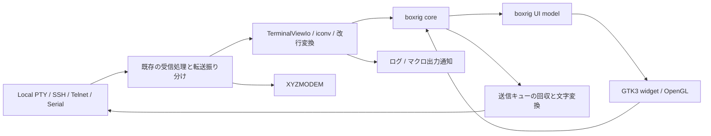

# boxrigへの端末基盤移行計画

## 目的と今回の成果

elder-termsの端末基盤をboxrig coreとboxrig UIのGTK3版へ移行する。描画にはOpenGLを使用し、boxrigをelder-termsのビルド中に共有ライブラリとして生成する。移行後はlibvteのコード、リンク、ビルド依存、配布依存を取り除く。

2026年10月13日、elder-termsの`9e71944da6d9a5f4f6b5f0a2d02ce7ccda7e17f8`を調査した。boxrigは公式リポジトリの`5ebe6420f6f81b4bf38d11fe233285f470a83ae6`、タグ`0.1.0`を`deps/boxrig`に追加した。入れ子のsubmoduleも固定コミットで初期化済みである。追加コミットは`f8b7aaa`。

今回の成果物はsubmodule追加と本計画である。共有ライブラリ化と端末の移行は、以下の段階に沿って別途実装する。機能の対応は、固定したboxrigの公式ドキュメント、公開ヘッダーのAPIコメント、必要箇所の実装を照合した結果であり、elder-termsとの結合動作を確認した結果ではない。

基本的な描画・入力・PTY・履歴・選択には対応機能がある。ただし、現在のアプリケーション機能をすべてAPIの一対一置換で移せるわけではない。PCRE2によるリンク認識、実行中の文字設定変更、入力禁止、端末側からのサイズ変更要求には、elder-terms側の接続処理が必要となる。

## 現行コードの責任分担

| 対象 | 現状と移行範囲 |
| --- | --- |
| [端末の起動処理](../../../elder-terms-vte/src/main.cpp) | VTE型登録、初期サイズ、履歴、ズーム、タイトルとベルのsignalを接続する。boxrigの生成・フレーム処理・ホスト通知へ置き換える。 |
| [ウィンドウ](../../../elder-terms-vte/src/main-window.cpp)と[UI定義](../../../elder-terms-vte/src/main-window.ui) | `VteTerminal`の配置、背景と文字色、選択コピー、貼り付け、リンク、入力禁止を扱う。GTKのメニュー、認証オーバーレイ、接続表示は引き続きアプリが管理する。 |
| [レイアウト](../../../elder-terms-vte/src/terminal-layout.cpp) | 文字セル寸法、フォント、ズーム、スクロールバー、geometry hints、最大化、端末由来のサイズ要求を扱う。boxrigの配置結果を基準に再構成する。 |
| [表示とI/Oの境界](../../../elder-terms-vte/src/terminal-sessions/terminal-view-io.cpp) | 受信を文字変換して`feed()`へ渡し、`commit`を文字変換して送信する。raw/cooked出力通知、実行中の設定変更、キー補正もここにある。移行の中心となる。 |
| [ローカルセッション](../../../elder-terms-vte/src/terminal-sessions/local-session/local-session.cpp) | `VtePty`で生成・起動・FD取得・リサイズを行う。読み書きは既にCardioで実装されており、boxrigのPTYへ差し替えられる。 |
| [SSH](../../../elder-terms-vte/src/terminal-sessions/ssh-session/ssh-session.cpp)、[Telnet](../../../elder-terms-vte/src/terminal-sessions/telnet-session/telnet-session.cpp)、[シリアル](../../../elder-terms-vte/src/terminal-sessions/serial-session/serial-session.cpp) | 通信、再接続、BREAK、XYZMODEM、送信処理はアプリ側の機能である。表示用I/O境界を差し替え、通信の所有者は維持する。 |
| [文字変換](../../../elder-terms-vte/src/terminal-sessions/terminal-text-codec.cpp)、[キー補正](../../../elder-terms-vte/src/terminal-sessions/terminal-keyboard-protocol.cpp) | iconvとカーソル列の変換は継続利用する。VTEの特殊キー補完はboxrigの出力との重複を調べて整理する。 |
| [リンク解決](../../../elder-terms-vte/src/terminal-hyperlink-resolver.cpp)と[共通PCRE2処理](../../../shared/src/settings/regular-expression.cpp) | コマンド引数、キャプチャ展開、パス検証、ルール優先順位を維持する。VTEに依存する画面上の候補検出だけを差し替える。 |
| [ルートビルド](../../../meson.build)、[端末ビルド](../../../elder-terms-vte/meson.build)、[Makefile](../../../Makefile) | 現在はMakeからnpm workspaces、Meson/Ninjaへ進む。既存の入口を維持し、boxrig用MakefileをMesonから呼び出す。 |
| [配布前提](../../../prereq.sh)、[パッケージ生成](../../../build_package.sh)、[コンテナ内ビルド](../../../scripts/build_linux_dist_container.sh) | 開発用VTEパッケージ、pkg-config検査、配置先、動的依存計算、インストール検証を更新する。 |

## libvte利用機能とboxrigの対応

「対応」は公開APIが存在することを示す。「接続処理が必要」は既存のアプリ機能を組み合わせる項目、「直接対応なし」は別の実装または先行検証が必要な項目である。

| 現行の利用 | boxrigの対応 | 接続方針 |
| --- | --- | --- |
| `VteTerminal`、`VTE_TYPE_TERMINAL` | 対応。`boxrig_terminal_create()`、`boxrig_ui_model_create()`、`boxrig_gtk3_terminal_widget_create()` | core、model、widgetを明示的に生成する。GtkBuilderには配置先を残し、生成済みwidgetを追加する。 |
| `vte_terminal_feed()` | 対応。`boxrig_terminal_feed()`、`finish_input()` | 消費バイト数と`WOULD_BLOCK`を処理し、未処理データを保持する。EOF時も末尾処理まで進める。 |
| `commit`によるキー・IME・端末応答の送信 | 接続処理が必要。UI入力と`boxrig_terminal_output_peek()`／`output_consume()` | フレーム処理後と受信解析後に出力を回収する。借用ポインターを非同期I/Oへ持ち越さない。 |
| BackspaceのAuto／BS／DEL、Deleteの自動処理 | 接続処理が必要。`send_key()`とkey router | 現行テストのAutoはBS、boxrigの通常BackspaceはDELである。Autoを含めてアプリ側の規則を定め、キー種別に基づき適用する。 |
| ReturnのAuto／CR／LF／CRLF | 接続処理が必要。生成時の`enter_newline`とkey router | 実行中の変更を維持するため、固定指定はアプリ側で扱う。通常Enterとkeypad、修飾キー、Kitty形式を区別する。 |
| 通常カーソル列とアプリ固有の1バイト変換 | 対応。coreのキー生成と既存`TerminalTextCodec` | `normal`はboxrigのモードに従う。既存の変換対象だけを変換し、Kitty形式などへ重ねて変換しない。 |
| Kitty keyboardの特殊キー補完 | 対応。coreの`boxrig_terminal_send_key()` | boxrigの標準エンコードへ集約する。現在の補完をそのまま重ねない。実行中の固定キー設定に必要な状態観測だけは別途検証する。 |
| iconvで指定可能な文字コード、受信改行変換 | 接続処理が必要。boxrig内蔵はUTF-8／Shift_JISと生成時設定 | coreをUTF-8・標準の受信動作に固定し、既存のiconv処理と受信改行処理を維持する。 |
| `vte_pty_new_sync()`、`spawn_async()`、`get_fd()`、`set_size()` | 対応。`boxrig_posix_pty_spawn()`、`descriptor()`、`child()`、`resize()`、`destroy()` | FDを既存Cardioへ接続する。子プロセス監視と起動失敗の扱いは別途補う。 |
| 列数・行数の取得と設定 | 対応。`boxrig_terminal_size()`／`resize()`、widgetの`set_preferred_grid()`／`get_layout()` | ウィンドウの希望サイズと、core・通信先で確定したサイズを分ける。 |
| 文字幅・高さ、geometry hints | 対応。`get_effective_metrics()`、`set_geometry_hints()` | GTK論理ピクセルと26.6固定小数の出力ピクセルを変換する。最大化・タイル状態ではウィンドウ側の割当を優先する。 |
| フォントfamilyとズーム | 対応。`set_font_specification()`、`get_effective_metrics()`、visual zoom API | 順序付きfamilyを渡し、現在の倍率設定を基準フォントのDIP寸法へ変換する。保存値0.5〜3.0と0.1刻みを維持する。 |
| 履歴上限と実行中の変更 | 対応。`scrollback_capacity()`、`set_scrollback_capacity()` | 現行の1,000〜100,000行を維持する。boxrigの上限1,048,576行に収まる。 |
| `GtkScrollable`のadjustmentと外部スクロールバー | 対応。widgetのscrollbar state／action | 現在のバーへ値と操作を接続する。boxrigの標準コンテナーを併設してバーを二重にしない。 |
| 選択有無とテキストコピー | 対応。`boxrig_ui_view_get_selection()`、widgetの`apply_view_action(COPY)` | 選択・コピーは入力禁止中も利用可能にする。PRIMARYとCLIPBOARDを区別する。 |
| 右クリック、Shift+Insert、中クリック、送信設定付き貼り付け | 接続処理が必要。key／mouse router、GTK clipboard | 既存の貼り付け経路を維持する。改行、行間待機、キャンセルを`TerminalTextSendRunner`へ渡し、boxrigの標準pasteと二重実行しない。 |
| `vte_terminal_set_input_enabled()` | 直接対応する単独setterはない | router、フォーカス、送信許可を接続する。既に保留中のIME・paste・キー解放が再接続後へ漏れないことを先行検証する。 |
| OSC 8のリンクと許可設定 | 対応。widgetの`hit_test()`、hit結果のURI | 有効・無効はアプリの操作判定で扱う。Ctrl+クリックを既存resolverへ接続する。 |
| `VteRegex`、match登録、イベント位置の正規表現照合 | 直接の互換APIはない。snapshotと位置変換、限定regex認識器がある | PCRE2を維持し、boxrigの論理行と位置を利用してリンク候補を検出する。 |
| 前景色、背景色、既定色への復帰 | 対応。viewのcolor filter／background API | 接続色による既定前景・背景の変更をfilterで表現する。SGRの明示色は維持し、設定解除時にfilterを戻す。 |
| タイトルsignalとtermprop取得 | 対応。`BOXRIG_HOST_ITEM_TITLE` | ホストキューから読み、現在の接続名との合成規則へ渡す。必要なタイトル保存・復元もホスト側で扱う。 |
| ベルsignalと内蔵beep切替 | 接続処理が必要。`BOXRIG_HOST_ITEM_BELL` | 既存の音声ファイル再生を維持し、既定beepはGTK/GDK側で鳴らす。boxrig自体にVTEの内蔵音を期待しない。 |
| `resize-window` signal | 直接対応なし | 現行が受けている端末由来の行列数変更を特定し、受信列の観測と`set_preferred_grid()`へ接続する。通常のウィンドウリサイズとは別に検証する。 |
| カーソル点滅、IME位置、マウス報告、代替画面 | 対応。標準UIとcore | GTKのイベントとboxrigのフレーム要求を継続処理する。通信が止まっている間の描画も確認する。 |

上表の基本APIは[GTK組み込みガイド](https://github.com/kekyo/boxrig/blob/5ebe6420f6f81b4bf38d11fe233285f470a83ae6/docs/ja/platforms/gtk.md)、[GTK3公開ヘッダー](https://github.com/kekyo/boxrig/blob/5ebe6420f6f81b4bf38d11fe233285f470a83ae6/include/boxrig/gtk3/terminal_widget.h)、[core公開ヘッダー](https://github.com/kekyo/boxrig/blob/5ebe6420f6f81b4bf38d11fe233285f470a83ae6/include/boxrig/terminal.h)に基づく。
PTYは[セッションガイド](https://github.com/kekyo/boxrig/blob/5ebe6420f6f81b4bf38d11fe233285f470a83ae6/docs/ja/sessions.md)と[POSIX公開ヘッダー](https://github.com/kekyo/boxrig/blob/5ebe6420f6f81b4bf38d11fe233285f470a83ae6/include/boxrig/posix.h)を参照する。

## 接続設計

### 表示と通信の所有者

elder-terms側に`TerminalView`のインターフェイスと生成・破棄関数を設ける。boxrigの具象型、UIフレーム処理、色、フォント、選択、ホスト通知をこの境界へ集める。実装は継承階層を追加せず、状態と関数、必要なコールバックの組み合わせで構成する。

アプリはcoreとmodelを所有し、GTKコンテナーはwidgetを所有する。widgetはmodelとcoreを借用する。セッションが借用する`TerminalView`は、接続解除や再接続の間も生存させる。再接続時に表示と履歴を作り直す設計にはしない。

既存セッションのCardioによる読み書き、SSH認証、Telnet制御列、シリアルの回線操作は継続利用する。boxrigの汎用sessionへFDを直接渡す方式は、文字変換・ログ・XYZMODEMとの経路を迂回するため採用しない。PTYはboxrigの公開POSIX APIからFDを取得し、既存セッションが読み書きする。

SFTP、FTP、FTPS、WebDAVの転送エンジンは表示置換の対象外である。ただしSSH端末からのSFTP起動と認証済み接続の共有、ファイル転送画面の同梱配置は回帰試験に含める。

### 受信、送信、フレーム処理

受信した通常端末データは、既存の文字変換と出力通知を通してcoreへ渡す。`feed()`が一部だけ消費した場合は変換済みの残りを保持する。同じ受信列に対してiconv、ログ、マクロ通知を再実行しない。保持量に上限を設け、満杯ならCardio側の読み込みを待機させる。

送信キューは端末からの応答とUI入力の両方を含む。`output_peek()`の借用範囲をアプリ所有のキューへ受け渡してから、受理した分だけconsumeする。部分書き込みや送信待ちがあっても順序を保ち、UTF-8が分割された場合は既存のストリーム変換器で続きを処理する。

`frame_request_callback`はGLib main contextへ処理を予約するだけにする。予約した処理でホスト要求、受信の残り、レイアウト要求を進め、modelをsynchronizeしてwidgetのframeを呼ぶ。UI入力が生んだ出力も回収する。コールバックやGTKのdrawから通信・描画を再帰的に呼ばない。

`additional_dispatch`が真なら追加処理を予約する。`frame_pending`だけが真の状態でidleを回し続けず、GTKの割当・描画通知などを待つ。GTK版はアニメーションruntimeをmain contextへ自動接続するため、独自の常時ポーリングやワーカースレッドは追加しない。[frameの契約](https://github.com/kekyo/boxrig/blob/5ebe6420f6f81b4bf38d11fe233285f470a83ae6/include/boxrig/gtk3/terminal_widget.h)、[点滅の接続](https://github.com/kekyo/boxrig/blob/5ebe6420f6f81b4bf38d11fe233285f470a83ae6/docs/ja/blinking.md)を参照する。

EOFでは受信残量と文字変換器の末尾を処理し、`boxrig_terminal_finish_input()`まで完了させる。終了時は新規処理を止め、通信タスクと遅延コールバックを切り離す。widgetをquiesce・破棄してからmodel、coreを解放する。再接続時はセッション世代を照合し、古い接続からの通知を新しい接続へ渡さない。

### OpenGLの指定と確認

GTK3 widgetの`render_policy`に`BOXRIG_GTK_RENDER_OPENGL_REQUIRED`を指定する。既定値はCairoなので、単にGTK3版をリンクしただけでは要件を満たさない。OpenGL contextの所有と描画はboxrigのGTK3実装へ任せる。

realizeと最初のフレーム完了後に`get_render_state()`を確認し、`active_backend`がOpenGL、`pending`がfalseとなることを検証する。GL初期化・描画失敗時は診断を利用者へ表示する。OpenGL必須の要求をCairoへの自動切替で満たしたことにはしない。

描画系の条件はOpenGL 3.3 coreまたはOpenGL ES 3.0である。自動試験はMesaのソフトウェアGLでも実行し、実機GPUでの表示は別に確認する。OpenGLを使っても文字描画にはPango/Cairoが必要となる。[描画方式](https://github.com/kekyo/boxrig/blob/5ebe6420f6f81b4bf38d11fe233285f470a83ae6/docs/ja/renderers.md)、[描画状態API](https://github.com/kekyo/boxrig/blob/5ebe6420f6f81b4bf38d11fe233285f470a83ae6/include/boxrig/gtk/rendering.h)を参照する。

### サイズ、フォント、スクロール

boxrigの`take_layout_action()`から要求を取得する。content-size要求はトップレベルのウィンドウへ伝え、子widgetの実際の割当後に同じrevisionを`complete_size_command()`へ返す。configure通知だけで完了扱いにしない。

grid-resize要求は通信先とcoreへ反映し、同じrevisionを`complete_grid_resize()`で完了する。現在のセッションの`resize()`は戻り値がvoidなので、成功・失敗を伝えられる境界へ改める。SSHのPTY要求、TelnetのNAWS、ローカルPTY、サイズ通知を持たないシリアルを区別する。未接続ならcoreだけを変更し、後の接続開始時に確定値を渡す。

失敗を成功として通知しない。boxrigの契約では失敗したgrid resizeはwidgetを停止するため、接続エラー表示と再作成まで含めて扱う。後続の割当要求は別revisionとして保持する。

現在のズーム値はアプリが保持し、基準フォントサイズから`boxrig_font_specification`のDIP値へ変換する。任意の保存倍率を近いvisual zoom段階へ丸めない。初期基準フォント、ポイントとDIP、出力DPI、GTK backing scaleを明示し、確定した有効セル寸法をウィンドウへ反映する。最大化、枠幅、コンパクト表示、フォントfallback順序も既存テストで確認する。[フォントと配置](https://github.com/kekyo/boxrig/blob/5ebe6420f6f81b4bf38d11fe233285f470a83ae6/docs/ja/fonts-and-layout.md)を参照する。

履歴バーは既存GTK scrollbarを維持し、boxrigのscrollbar stateのrevisionが変わったときに更新する。バー操作は`apply_scrollbar_action()`へ渡す。履歴中の受信、最下行追従、代替画面、履歴容量の縮小、幅変更時の折り返し直しを確認する。[スクロールバーの例](https://github.com/kekyo/boxrig/blob/5ebe6420f6f81b4bf38d11fe233285f470a83ae6/examples/gtk3/external_scrollbar.h)を参照する。

### 文字設定、貼り付け、入力禁止

boxrigの`encoding`、受信・送信改行、`key_mappings`は生成時の設定である。現在のelder-termsは設定を接続中に変更できるため、これらを更新する目的でcoreを破棄してはならない。coreはUTF-8で使用し、iconvと受信改行変換、カーソル列変換をアプリ側に残す。[送受信設定の制約](https://github.com/kekyo/boxrig/blob/5ebe6420f6f81b4bf38d11fe233285f470a83ae6/docs/ja/terminal-io.md)を参照する。

固定Backspaceと固定Returnはkey routerで捕捉する。BackspaceのAutoも、[ローカル](../../../elder-terms-vte/tests/local-session.test.ts)と[Telnet](../../../elder-terms-vte/tests/telnet-session.test.ts)の現行テストが期待するBSを維持する。通常のキー・修飾キー・keypad・Kitty modeの扱いを現行テストから確定し、boxrigで生成すべきイベントとアプリが送る固定列を分ける。`output_peek()`全体に対するBS、DEL、CRの一括置換は、IME文字や端末応答を誤変換するため行わない。

キーの捕捉は押下、リピート、解放を一組で扱う。boxrigのkey routerは押下で捕捉した系列を解放までアプリへ渡す。通常入力をGTKのkey eventとboxrigの両方から送らない。現在の`TerminalKeyboardProtocolState`は、固定キー設定との両立に必要な状態観測を確認したうえで整理する。boxrigが既に生成する特殊キー列の補完と、そのためだけの保留キー処理は削除する。[入力routerのAPIコメント](https://github.com/kekyo/boxrig/blob/5ebe6420f6f81b4bf38d11fe233285f470a83ae6/include/boxrig/ui/input.h)、[Backspaceの実装](https://github.com/kekyo/boxrig/blob/5ebe6420f6f81b4bf38d11fe233285f470a83ae6/src/core/input.c)が確認対象である。

貼り付けは現在のGTK clipboard取得と送信runnerへ統一する。メニュー、Shift+Insert、中クリックなどの入口を同じ処理へ渡し、既存の改行変換・速度制御・キャンセルを保つ。現在の仕様どおりBracketed Pasteを自動追加しない。単純なキーボード入力と、アプリの分割送信は別の経路として識別する。

入力禁止はwidget全体のsensitiveを落とすだけでは実現できない。切断中や転送中も履歴閲覧と選択コピーを維持する必要がある。key／mouse routerで入力を捕捉し、貼り付けの許可を既存の接続状態で判定する。モーダルダイアログ表示中も含め、フォーカス移動とcompositionの取消を組み合わせる。保留IMEや非同期clipboard応答が送信されないことを実行ドライバーで確認する。

送信停止中のUI出力をcoreに溜め、再接続時にまとめて送る動作は禁止する。通常の端末応答と利用者入力を混同して破棄しないよう、通信の停止・入力の許可・フレームからの送信受付を分ける。公開APIだけでこの制御を実現できない場合は本体切替を止め、必要な上流APIを特定して計画を更新する。内部input構造へアクセスする回避策は採用しない。

### リンク判定、色、ホスト通知

boxrigのregex認識器は限定構文で、PCRE2の先読み・後読み・後方参照などと同じ機能ではない。現行の任意ルールを狭い構文へ置き換えず、共通PCRE2処理を使う。hit testの論理位置から対象行のsnapshotを取得し、折り返しをつないだUTF-8文字列上でクリック位置を含む一致を探す。

同じ行に複数の一致がある場合に、常に先頭一致を選ばないようにする。現在の共通検索関数は先頭一致だけを返すため、開始offsetを指定して反復できる公開境界を追加する。ゼロ長一致、UTF-8境界、結合文字、幅広文字、双方向文字、履歴中の位置をテストする。全履歴をポインター移動ごとに複製せず、論理行IDとtext revisionに対応した結果を保持する。

OSC 8はhit結果のURIをコピーし、現在のresolverへ渡す。URIの有無、正規表現ルール順、キャプチャ、引数テンプレート、ローカルパス検証を維持する。古いlayout generationやtext revisionの候補は再取得する。hover時のpointer表示も同じ候補判定を使う。[文字列・regexの制約](https://github.com/kekyo/boxrig/blob/5ebe6420f6f81b4bf38d11fe233285f470a83ae6/docs/ja/text.md)、[位置と選択のAPI](https://github.com/kekyo/boxrig/blob/5ebe6420f6f81b4bf38d11fe233285f470a83ae6/include/boxrig/ui/view.h)を参照する。

接続色はcolor filterで既定前景・背景に適用し、明示SGR色、反転、カーソル、IMEとの関係を試験する。設定値を変更したら`invalidate_colors()`を呼ぶ。切断時のdim overlayと認証overlayがGL面の上へ正しく合成されることも確認する。[色補正ガイド](https://github.com/kekyo/boxrig/blob/5ebe6420f6f81b4bf38d11fe233285f470a83ae6/docs/ja/color-filters.md)、[色の出自とfilterのAPI](https://github.com/kekyo/boxrig/blob/5ebe6420f6f81b4bf38d11fe233285f470a83ae6/include/boxrig/ui/color.h)に従う。

ホストキューはタイトルとベルを既存処理へ接続する。タイトル・payloadは借用期間中にコピーする。既存のカスタム音声再生に加え、既定音と再生失敗後のbeepをGTK/GDKへ接続する。

アプリで扱わないホスト要求もconsumeし、request IDがある場合は一度だけ`UNAVAILABLE`などの完了を返す。キューや応答待ちを残して後続送信を停止させない。OSC 52、通知、外部画像データの新規機能追加はこの移行に混ぜない。[ホスト要求の契約](https://github.com/kekyo/boxrig/blob/5ebe6420f6f81b4bf38d11fe233285f470a83ae6/docs/ja/host-integration.md)を参照する。

### 直接対応しない機能の扱い

現行の`resize-window`は、通常状態で受けた行列数を希望サイズへ反映し、最大化・タイル状態では無視する。boxrigには同名の通知やresize用host itemがない。公開仕様と実装では`CSI 14 t`／`16 t`の寸法問い合わせとタイトル保存・復元は確認できるが、`CSI 8 ; rows ; columns t`のホストサイズ要求は確認できない。[制御列一覧](https://github.com/kekyo/boxrig/blob/5ebe6420f6f81b4bf38d11fe233285f470a83ae6/docs/ja/reference/terminal-sequences.md)、[CSI処理](https://github.com/kekyo/boxrig/blob/5ebe6420f6f81b4bf38d11fe233285f470a83ae6/src/core/interpreter.c)を参照する。

実装時はまず現行VTEの実行結果から、受け付ける要求と0値などの意味をテストで固定する。その結果に必要な範囲だけ、アプリ側で分割受信可能な制御列観測を追加する。OSC・DCS内の似た文字列を誤認せず、正常に消費された通常端末入力だけを観測する。転送payloadを対象にしない。通知はフレーム処理へ予約し、既存のサイズ制約とboxrigの配置要求を通す。

boxrigのGTK3 widgetにはterminal roleがあるが、AtkTextによる本文・変更・選択の公開は未対応である。現行コードに明示的なAtkText操作はないものの、VTE由来の読み上げ機能まで同等と断定しない。段階4で実際の利用境界を確認する。必要な本文・選択の公開はGTK/ATKの公開APIとboxrig snapshotを使うアプリ側のaccessible adapterで検討し、未解決のまま同等性を完了扱いにしない。[上流のアクセシビリティ対応範囲](https://github.com/kekyo/boxrig/blob/5ebe6420f6f81b4bf38d11fe233285f470a83ae6/docs/ja/reference/platform-support.md#ime通知クリップボードアクセシビリティ)を参照する。

### ローカルPTYの起動と終了

`boxrig_posix_pty_spawn()`に既存のargvと初期行列数、明示した`TERM`を渡す。既定シェルの選択、PATH検索、引数の引用処理、環境継承は現在の動作をテストで固定する。子を起動する前にUIへ接続中を通知し、生成したnonblocking FDをCardioへ渡す。

boxrigのspawnは同期APIで、子の`execvp()`失敗は子プロセスの終了値127となる。VTEの非同期起動完了通知とは異なるため、成功戻り値だけでコマンドの起動成功を保証しない。起動失敗・即時終了を接続状態と診断へ反映する。[PTY実装](https://github.com/kekyo/boxrig/blob/5ebe6420f6f81b4bf38d11fe233285f470a83ae6/src/posix/pty.c)を参照する。

`boxrig_posix_pty_wait()`はblocking waitなのでGTKのスレッドでは呼ばない。子PIDをGLib child watchで一度だけ回収し、終了通知の重複を防ぐ。`destroy()`はFDを閉じるが子の終了・回収までは行わない。ウィンドウ閉鎖、起動直後の中止、再接続では、アプリが子への終了要求と回収を管理する。GL初期化後のforkとFD継承、エラー経路も先行検証の対象とする。

## 共有ライブラリのビルドと配布

### 上流を変更しないビルド構成

固定したboxrigのLinux向け標準成果物は`libboxrig.a`、`libboxrig-ui.a`、`libboxrig-gtk3.a`などの静的ライブラリである。利用できる共有ビルドオプションがあると仮定しない。[上流のビルドガイド](https://github.com/kekyo/boxrig/blob/5ebe6420f6f81b4bf38d11fe233285f470a83ae6/docs/ja/building.md)、[Makefile](https://github.com/kekyo/boxrig/blob/5ebe6420f6f81b4bf38d11fe233285f470a83ae6/Makefile)が根拠となる。

elder-terms側の`build-support/boxrig.mk`とMeson用の定義を追加する。上流Makefileの対象ソースとコンパイル条件に基づき、core、共通UI、GTK3、GTK用GL面、OpenGL renderer、文字描画・IBus補助、必要なPOSIX PTY実装をC99・`-fPIC`でビルドする。単一の私有共有ライブラリ`libelder-terms-boxrig.so`へリンクする。

POSIX側は利用する`pty.c`から始め、汎用sessionのI/Oループはリンク対象へ加えない。GTK3側は上流の`GTK3_OBJECTS`に相当する構成を確認し、GL用の`BOXRIG_GTK_OPENGL=1`を指定する。GTK3用archiveにもOpenGLのobjectが含まれる上流構成なので、別のOpenGL archiveを重ねてwhole-archiveリンクする方法は避ける。共通のPango候補表示objectなども一度だけ含める。

生成物は`.build/boxrig/`へ集める。libpng設定は上流のprebuiltヘッダーをビルド領域へ配置し、同梱のUnicode・Shift_JISデータは固定ソースを利用する。text processingが必要になれば既存のNode.js・TypeScript・funcityを使う。上流ディレクトリへソース修正、独自パッチ、成果物を書き込まない。

utf8proc、libpng、zlibもPICでビルドし、上流どおり内部codecのsymbol visibilityをhiddenにする。共有ライブラリのexportは利用する公開APIを明示したlinker version scriptで制御し、`boxrig_*`というprefixだけで内部APIまで公開しない。GTK/GdkPixbuf側のPNG・zlibとのsymbol衝突を実行試験で検出する。`--no-undefined`、SONAME、C++からのリンクも検証する。

共通UIとPOSIXのヘッダーはcoreと同じC++ linkage guardを一律に持たない。GTKなどのシステムヘッダーを先に読み、必要なboxrig宣言をアプリ側のC linkage wrapperへまとめるか、薄いC99 bridgeから呼ぶ。上流のヘッダーを直接編集しない。[core](https://github.com/kekyo/boxrig/blob/5ebe6420f6f81b4bf38d11fe233285f470a83ae6/include/boxrig/terminal.h)、[UI](https://github.com/kekyo/boxrig/blob/5ebe6420f6f81b4bf38d11fe233285f470a83ae6/include/boxrig/ui/view.h)、[POSIX](https://github.com/kekyo/boxrig/blob/5ebe6420f6f81b4bf38d11fe233285f470a83ae6/include/boxrig/posix.h)の宣言を参照する。

boxrig内部のcardio submoduleは取得しても、このC99の構成へ別のCardio runtimeとしてリンクしない。elder-termsとlibxyzmは現在の共有`libcardio.so`を継続利用する。GTK4、native X11／Waylandの別component、Windowsデモはこのビルドに含めない。

### Mesonと増分ビルド

現在のMake → npm → Mesonの入口からcustom targetで専用Makefileを呼ぶ。boxrigのヘッダー、ソース、submodule更新、生成設定、専用Makefileの変更を依存関係へ含める。Make側は依存ファイルを生成し、ソース・フラグ変更後に必要なobjectだけを再生成する。クリーンビルド、二回目のビルド、変更後の再リンクを検証する。

Mesonは生成された共有ライブラリへのリンクとビルド順を宣言し、通常ビルドからdriver・本体の起動まで完結させる。C99 bridgeを採用する場合はMesonのprojectへC言語も追加する。`-L`だけを追加してシステム上の別boxrigを偶然リンクする構成にはしない。submodule未初期化は早期に検出し、`git submodule update --init --recursive`を案内する。

ホストGCC、C99/C++20、既存のwarnings-as-errorsを維持する。上流GTK3ビルドにはdeprecated warningの限定抑制があるため、その対象と理由を確認する。アプリ側の新規呼び出しへ同じ抑制を広げず、公開・非deprecated APIだけを使う。不要なプラットフォームのpkg-config検出が出す警告も、専用Makefileで検出対象を限定して避ける。

### 開発依存と配布先

GTK3は3.24以上、Pangoは1.50以上、Cairoは1.18以上、IBusは1.5.29以上を要求する。Wayland clientは上流のGTK3 pkg-config定義に合わせて1.22以上とし、PangoCairo、PangoFT2、Fontconfig、libepoxyとGLの開発環境も用意する。GTK3経由のOpenGLでもCairo依存は残る。[上流pkg-config定義](https://github.com/kekyo/boxrig/blob/5ebe6420f6f81b4bf38d11fe233285f470a83ae6/pkgconfig/boxrig-gtk3.pc)を参照する。

`prereq.sh`と利用者向けのビルド案内に必要な開発パッケージを追加し、`libvte-2.91-dev`を削除する。候補は`libcairo2-dev`、`libpango1.0-dev`、`libfontconfig1-dev`、`libepoxy-dev`、`libibus-1.0-dev`、`libwayland-dev`、`libgl-dev`、`libegl-dev`である。テスト用にはMesaのソフトウェアGLと既存のGTK試験環境を用意する。最終的なリンク依存は段階1で検証して確定する。

現在の配布行列にはDebian bookwormが4件含まれる。bookworm標準の[Cairo 1.16.0](https://packages.debian.org/bookworm/libcairo2-dev)と[IBus 1.5.27](https://packages.debian.org/bookworm/libibus-1.0-dev)は上記条件を満たさない。後方互換性を求めない方針に従い、本計画ではbookwormを対象から外す。Debian trixieの5アーキテクチャ、Ubuntu 24.04／26.04の各2アーキテクチャ、合計9件を対象とする。旧環境向けのGUI基盤一式の同梱は行わない。

共有ライブラリは既存の私有libdirである`lib/elder-terms/`へ同梱する。子実行ファイルは同dir直下の専用サブディレクトリに置き、現在の`$ORIGIN/..`を維持する。共有ライブラリが同階層の私有ライブラリへ依存する場合は、自身にも`$ORIGIN`のRUNPATHを設定する。

`dpkg-shlibdeps`の入力へ新しい共有ライブラリを追加する。パッケージの配置・依存・ロード検査は、stagingとインストール後の両方で行う。build pathやホストの`LD_LIBRARY_PATH`を使わず起動し、boxrigが共有オブジェクトとしてロードされることを確認する。boxrigと組み込むutf8proc、libpng、zlib、Unicode・文字コードデータのライセンス表示も同梱する。[配布条件](https://github.com/kekyo/boxrig/blob/5ebe6420f6f81b4bf38d11fe233285f470a83ae6/docs/ja/reference/distribution.md)、[ライセンス一覧](https://github.com/kekyo/boxrig/blob/5ebe6420f6f81b4bf38d11fe233285f470a83ae6/packaging/licenses/README_ja.md)を参照する。

## 段階的な実装

各段階で先に機能を検証するテストを追加し、REDを確認してから実装する。GREENになった段階で適切な粒度のコミットを作る。表示と通信を観測できるdriverを段階1から維持し、本体切替前にも実行可能な成果物を残す。

### 段階0 調査とsubmodule固定

`deps/boxrig`の追加、再帰的な初期化、機能対応と差分の整理を行う。今回実施済みであり、追加コミットは`chore: add boxrig submodule`とした。本計画は`doc:`コミットで保存する。

完了条件は、上流公開コミットを指していること、外部ソースに変更がないこと、主要なVTE利用箇所と直接対応しない機能を本計画から追えることである。

### 段階1 共有ライブラリとGTK3 OpenGLドライバー

専用Makefile、Mesonのcustom target、C++からの呼び出し境界を追加する。driverは共有ライブラリをロードして固定の端末出力を表示し、フレームとレイアウト要求を処理する。GTK3＋OpenGLの実状態と、クリック・選択・リサイズの結果を観測できるようにする。既存製品はこの段階では通常どおりビルドできる状態を保つ。

REDは共有ライブラリを使ったdriverがまだ表示できない状態で確認する。GREENでは、日本語と属性付き文字を表示し、GL backendの確定、ウィンドウ変更、PNGを使う既存GTK処理との共存を確認する。クリーン・増分ビルドとstagingからのロードも通す。

完了条件は、アプリの通常ビルドから私有共有ライブラリとdriverを生成でき、submoduleを汚さずOpenGLの表示に成功すること。コミット例は`feat: build boxrig shared library and GTK3 driver`。

### 段階2 入出力境界とローカルPTY

`TerminalView`境界、受信保留、送信キュー回収、ホスト通知、破棄順を実装し、driverからローカルシェルを操作可能にする。既存のargv設定を使い、PTYのFDをCardioへ接続する。既存アプリとの併存が必要な期間は、通信側の狭いインターフェイスだけを共有する。

REDはシェル出力、入力バイト、DSRなどの端末応答、設定行列数、起動失敗、閉鎖を外部から観測する試験で確認する。GREENでは部分受信・部分送信・queue満杯、EOF末尾、連続リサイズ、子の終了と再接続を通す。

完了条件は、ローカルの対話操作が継続でき、データの欠落・二重送信と残存子プロセスがないこと。コミット例は`feat: connect boxrig view to local terminal sessions`。

### 段階3 文字設定と全通信方式

文字コード、受信改行、Return、Backspace、カーソルキー、Kitty、IME、送信runner、ログとマクロを接続する。SSH、Telnet、シリアルを同じ表示境界へ接続し、driverから設定した通信先へ接続できるようにする。XYZMODEM中の入出力振り分けと、SSH proxy・SFTP接続共有も維持する。

REDは通信相手で受け取るバイトとログ・マクロの結果で確認する。GREENでは実行中の設定変更、貼り付け、送信中止、再接続、BREAK、ZMODEM自動開始を通す。入力禁止と保留IMEの試験もここで解決し、未解決なら段階4へ進まない。

完了条件は、4種類の端末接続で入出力・設定・転送の既存機能が成立すること。コミットは通信方式や入力機能ごとに`feat:`／`refactor:`へ分ける。

### 段階4 本体ウィンドウの切替

GtkBuilderの配置、レイアウト、フォント、履歴バー、コピーとコンテキストメニュー、リンク判定、色、タイトル、ベル、認証・切断overlayをboxrigへ切り替える。端末側のサイズ要求とアクセシビリティの差分もこの段階で判定・対応する。段階1のdriverで確認した処理を本体と共有し、製品用に別実装を増やさない。

REDは現行の各UI機能を操作する試験で確認する。切替によって消える旧backendについては、libvteを持たない実行環境で製品を起動する一時的な除去確認を先に追加し、切替前に失敗することを確認する。GREEN後、本体のリンクから`vte-2.91`を外した状態を一度コミットする。

完了条件は、launcherから実際の端末を開き、表示・操作・認証・転送・再接続が成立し、入力禁止中も選択コピーが使えること。コミット例は`feat: replace terminal window with boxrig GTK3 UI`。

### 段階5 VTE参照と不要コードの除去

`elder-terms-vte`のディレクトリ、workspace、実行ファイルを`elder-terms-terminal`へ改名する。launcherの探索、`ELDER_TERMS_VTE_PATH`などの環境変数、desktop ID、WM class、ビルド定義、配置先、テスト補助名を更新する。旧名のaliasやVTE fallbackは残さない。

使わなくなったVTE adapter、型、signal、version分岐、キー補完、フォント補助、fixture操作を削除する。既存の機能を説明するコメントは新しい実装へ合わせて更新し、理由なく削らない。PCRE2、iconv、Cardioのように引き続き必要な依存は残す。

日本語の利用者ドキュメントを原本として更新し、英語へ反映する。README、配布・検証ガイド、翻訳対象、過去計画から現存コードへのリンクも確認する。移行前の調査を記録した本計画やGit履歴は履歴資料として扱い、稼働する依存参照とは区別する。

除去対象の挙動を確認する一時テストは、RED・除去・GREENのコミット後に削除し、別の`chore:`コミットを作る。通常の端末機能試験は維持する。完了条件は、稼働コード、現行の操作案内、ビルド・配布設定にVTEへの依存と旧backend選択経路が残らないこと。

### 段階6 配布と全体検証

必要な開発依存、bookwormの対象除外、共有ライブラリの同梱、RUNPATH、動的依存計算、ライセンスを配布処理へ反映する。配布対象変更にも除去確認のRED・GREEN・一時テスト削除の手順を適用する。

新しい各パッケージをクリーンな環境へインストールし、launcher、端末、ファイル転送を通常の入口から起動する。libvteを入れずに起動・接続・表示できることを確認する。後述の全体テストと残存参照の監査を行い、最終完了条件へ結果を照合する。

完了条件は、対象9件の配布ビルドとインストール検証、全体テスト、共有ライブラリの実ロード確認が完了すること。コミット例は`chore: package boxrig runtime and remove VTE dependencies`。

## テスト方針

新規のC/C++試験は既存のMeson登録へ追加し、意味のある入出力を確認する。GTKの操作試験は現在のVitest・gestament・Xvfbを利用する。ブラウザやmuonを経由する試験は追加しない。

| 検証対象 | 観測する結果 |
| --- | --- |
| 起動とGL | 初回フレーム、GL backend確定、初期化失敗の表示、インストール先の共有ライブラリのロード |
| 入出力 | ASCII、日本語、幅広・結合文字、SGR、代替画面、端末応答、文字コード変換、分割データの順序 |
| キーとIME | 通常・修飾・keypad・Kittyの実バイト、IME確定の一回送信、実行中の設定変更、入力禁止への遷移 |
| 通信 | Local／SSH／Telnet／Serial、SSH proxy、Telnet NAWS、BREAK、切断・再接続、子の回収 |
| 転送・送信 | XYZMODEM、自動開始、転送payloadの表示除外、貼り付けとテキスト送信の待機・中止、SFTP共有 |
| 表示操作 | フォントfallback、ズーム、最大化、枠幅、コンパクト表示、履歴追従、選択コピー、背景とoverlay |
| リンク | OSC 8と通常テキスト、同一行の複数一致、PCRE2固有構文、折り返し、履歴、キャプチャと操作先 |
| ホスト通知 | タイトルと保存・復元、既定音とカスタム音、未対応要求を処理した後の送信継続 |
| 終了と負荷 | queue上限、部分消費、長い連続出力、100,000行履歴、未処理IME・clipboard・resizeを持つ閉鎖 |

フォントと描画方式の変更により既存のマスター画像は一致しない可能性がある。先に文字内容、座標、選択範囲、送信バイトを検証し、画像を変更する場合は一枚ずつ目視確認する。差分を消す目的で許容値を広げない。

点滅、連続ズーム、リサイズ、IME・overlayの切替は動画を撮り、必要な時間軸の挙動をアサートする。固定時間sleepだけで成功を推測せず、layout revision、接続状態、GL描画完了、通信相手の応答を待つ。負荷やエミュレーションで時間が必要な試験は、原因を確認してtimeoutを調整する。

完了時は`npm test --workspaces`で全体を実行する。現行ではshared、launcher、端末のVitestと端末workspace内の`meson test -C .build`が含まれる。改名後も同じ入口で全体が実行されるようにする。途中の個別試験だけで完了扱いにしない。

## 最終完了条件

- `deps/boxrig`とその依存が上流公開コミットに固定され、外部ソースが変更されていない。
- 通常のelder-termsビルドでPICの共有boxrigライブラリと実行ファイルを生成し、配布先から同梱ライブラリをロードできる。
- GTK3 widgetでOpenGLを使用し、初回フレーム後の実状態で確認できる。
- 機能対応表の各項目について、現行機能を操作・通信・表示で検証した結果がある。直接対応しない項目も解決されている。
- ローカル、SSH、Telnet、シリアル、文字設定、リンク、コピー、送信、転送、再接続が成立する。
- libvteのヘッダー、型、API、signal、version分岐、リンク・pkg-config・パッケージ依存、旧backend選択経路が残っていない。
- `readelf`等による依存監査と、libvteのない環境での実起動が成功する。残存文字列の検索だけを機能試験の代わりにしない。
- 不要な補助コードと一時的な除去確認テストを整理し、通常の機能試験を維持している。
- 全体テスト、配布対象9件のビルド・インストール検証、画像の目視確認、必要な動画アサートが完了している。

## 今回の確認結果

段階0の完了条件を確認した。boxrigのsubmoduleと入れ子の固定コミットを取得し、submodule内の作業ツリーに変更がないことを確認した。対応表と接続方針は、現行コードと固定版の公開APIを根拠としている。

全体テストとして`npm test --workspaces`を実行したが、3つのworkspaceすべてでビルド前処理が停止した。`scripts/test-fonts.mts`がimportする`funcity`が未導入で、`ERR_MODULE_NOT_FOUND`となったためである。テスト本体は実行されていない。再実行にはプロジェクトルートで`npm ci`による依存導入が必要となる。

GTK3、Cairo、Pango、libepoxy、IBus、Wayland clientのpkg-config情報は取得できた。共有ライブラリの生成、OpenGLの実描画、各通信方式との結合、配布試験は段階1以降の完了条件であり、今回の計画作成では未実施である。
