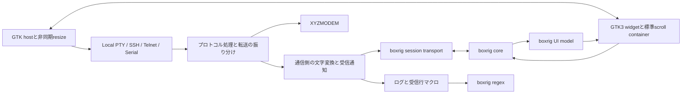

# boxrigへの端末基盤移行計画

## 目的と調査状況

elder-termsを、最初からboxrigで実装した端末アプリケーションとして再構成する。端末基盤にはboxrig coreとboxrig UIのGTK3版を使い、描画方針は`BOXRIG_GTK_RENDER_OPENGL_PREFERRED`とする。OpenGLを優先し、利用できない環境ではboxrigのCairo fallbackで動作を続ける。

boxrigは`deps/boxrig`のsubmoduleから、elder-termsの通常ビルド中に共有ライブラリとして生成する。移行後はlibvteへの参照と、elder-terms自身のPCRE2利用・直接依存を削除する。VTE型・signal・座標補正を再現する互換層や、旧backendへの切り替えは残さない。

調査対象のelder-terms実装は`9e71944da6d9a5f4f6b5f0a2d02ce7ccda7e17f8`。boxrigは`5ebe6420f6f81b4bf38d11fe233285f470a83ae6`、タグ`0.1.0`を追加し、入れ子のsubmoduleも初期化した。追加コミットは`f8b7aaa`である。

2026年10月14日、boxrigを前提とした設計へ計画を改訂した。前版のPCRE2維持、VTE倍率の再現、既存スクロールバーの維持、キー状態の再解析、端末由来resizeのアプリ側解析は採用しない。必要なAPI、追加しない場合の機能差、担当と受け入れ試験は[API要件資料](../boxrig-api-requirements.md)へまとめた。

今回の成果物は調査・計画であり、移行コードの実装ではない。公開APIの存在と契約は確認したが、elder-termsとの結合動作は未検証である。追加案のAPIが現行boxrigに存在するものとして実装を始めない。

## 機能の対応と不足

以下のIDはAPI要件資料と共通である。「既存API」はVTE互換を意味せず、boxrigの責任分担に従って実現できる項目を示す。

| 現行機能・利用箇所 | boxrigでの構成 | 方針 |
| --- | --- | --- |
| `VteTerminal`生成、`feed`、`commit` | core、UI model、GTK3 widget、sessionのdispatchと出力キュー | VTEの入出力signal中心の構造を廃止し、モデル更新とフレーム処理へ改める |
| ローカルPTYの生成、FD、行列数変更 | `boxrig_posix_pty_spawn()`、`descriptor()`、`resize()` | Cardioへ接続する。起動完了の診断はP1 |
| 通常ウィンドウのサイズ変更、希望行列数、フォント変更 | preferred grid、layout action、font specification、visual zoom | 既存API。旧補正コードを丸ごと撤去する |
| 履歴容量、スクロール、選択、コピー、IME、mouse report、代替画面 | coreと標準GTK3 UI | 既存API。scroll containerもboxrigの標準を使う |
| 切断・転送・モーダル中の入力禁止 | UI input policy | I1。保留入力を含む可逆な禁止機能を上流へ追加する |
| Return、Backspace、TRS-80設定と接続中の変更 | core input policyとkey mapping | K1。実行中の交換とBackspace設定を上流で扱う |
| Kitty keyboardの特殊キー補完 | coreのキー生成 | 既存API。アプリのKittyパーサーとcommit補正を削除する |
| iconvの任意文字コード | UTF-8のcoreと通信側の文字変換 | アプリ機能として分離する。キー列を書き換える機能を持たせない |
| OSC 8取得と画面リンクの認識 | hit test、text recognizer、annotation | 既存APIにR1・R2を加え、全regexをboxrigへ統一する |
| マクロ、ルール検証、番号・名前付きテンプレート | 独立したboxrig regex・capture APIとアプリの受信行／実行管理 | R1・R2。画面内容だけの監視へ意味を変えない |
| 色、接続背景、タイトル、ベル | color filter、background、TITLE／BELL host item | 色の適用規則、タイトル合成、音声再生はアプリが接続する |
| メニュー・中クリック等からの速度指定付き貼り付け | router、GTK clipboard、アプリの送信サービス | 選択コピーは標準UIを使い、送信ポリシーはアプリに残す |
| `resize-window`で受ける端末側の要求 | typed host itemからpreferred gridへ | W1。通常のwindow resizeとは別にcoreへ通知APIを追加する |
| Linux共有ライブラリ、C++リンク | PICビルドと公開C ABI | B1。上流整備を推奨し、親Makefileでの構築も可能 |
| 読み上げ・本文アクセシビリティ | GTK3 widgetのAtkText | A1。現行との差を観測し、上流対応範囲を判断する |

調査元は[起動処理](../../../elder-terms-vte/src/main.cpp)、[ウィンドウ](../../../elder-terms-vte/src/main-window.cpp)、[レイアウト](../../../elder-terms-vte/src/terminal-layout.cpp)、[TerminalViewIo](../../../elder-terms-vte/src/terminal-sessions/terminal-view-io.cpp)、[共通regex](../../../shared/src/settings/regular-expression.cpp)である。上流は[GTKガイド][gtk-guide]、[GTK3公開ヘッダー][gtk-api]、[core公開ヘッダー][core-api]を基準にする。

## boxrigを前提とする構造

### 所有権と責任

アプリに端末runtimeを設け、core、model、GTK3 widgetへの接続、接続世代、フレーム予約を管理する。GTKコンテナーがwidgetを所有し、widgetはmodelとcoreを借用する。通信方式ごとのオブジェクトはGtkWidgetやVTE互換インターフェイスを持たず、受信・送信・resize・終了を提供する通信機能へ分離する。

既存の通信実装、SSH認証、Telnet制御列、シリアル操作、BREAK、XYZMODEMは再利用できる。`TerminalViewIo`を残して関数名だけ差し替える移行は行わない。再利用するのは表示と独立した処理に限り、所有権と呼び出し境界を改める。新しい境界は関数表と状態の組み合わせを基本にし、backendクラスの継承階層を増やさない。

通信を切断・再接続しても、表示と履歴を所有するcoreは維持する。接続ごとのsessionとキューを終了させ、次の接続世代へ古い入力やコールバックを渡さない。終了時は新規要求を止め、Cardioタスクとフレーム予約を切り離し、widgetをquiesce・破棄してからmodelとcoreを解放する。sessionは借用するcoreとtransportより先に破棄する。

### 受信と送信

boxrigの[session API][session-api]を基本にし、Cardioの非同期処理が用意したキューを非ブロッキングtransport callbackへ接続する。callback内では待機しない。準備できないときは`WOULD_BLOCK`を返し、実際に準備ができた通知からdispatchを予約する。FDを直接sessionへ渡すことだけを組み込み方法としない。

通常受信をプロトコルと転送処理から分離し、文字変換前をrawログ、変換後をcookedログとマクロへ一度通知する。coreへ渡すUTF-8列はsessionの有限バッファで保持し、部分消費や再試行で変換・通知を繰り返さない。XYZMODEMのバイナリをcoreやregexへ投入しない。

送信もアプリ所有の有限キューで受理した量だけを報告する。coreの借用バッファを非同期処理へ持ち越さない。端末応答と利用者入力の順序、送信中止、転送開始、再接続を同じ通信サービスで管理する。キュー満杯で読み込みを待機させる機構を設け、無制限に蓄積しない。

任意encodingはアプリのiconv変換として維持する。coreはUTF-8を使い、内蔵Shift_JISと二重変換しない。変換器からはTRS-80変換とキー補正を削除する。EOFでは変換器の末尾を一度排出してからCLOSEDを返し、sessionの`finish_input()`と`peer_closed`まで処理する。

### フレームとホスト要求

`frame_request_callback`はGLib main contextへ処理を予約するだけにする。処理時にsession、host queue、認識器、layout actionを有限量ずつ進め、modelをsynchronizeしてwidgetのframeを呼ぶ。GTKのdrawやboxrigのcallbackから通信・frameを再帰的に呼ばない。

`additional_dispatch`なら追加処理を予約し、`frame_pending`だけでidleを回し続けない。通信の準備、GTKの割当・描画、入力など、進展に必要な通知を待つ。GTK版がmain contextへ接続するアニメーション機構を使い、描画を進めるための固定周期pollingを作らない。[GTKのframe契約][gtk-api]と[点滅の接続][blinking-guide]に従う。

TITLEとBELLはアプリのタイトル合成と音声再生へ接続する。payloadは借用期間中にコピーする。未対応のhost requestもconsumeし、request IDがある場合は拒否・利用不可を一度返して出力の順序待ちを解消する。OSC 52、通知、外部画像データを利用者向けに新規提供することは、本移行の必須範囲に含めない。[ホスト要求の契約][host-guide]を参照する。

## サイズとフォントを管理する唯一の経路

### 通常の操作

初期行列数と明示的な変更は`set_preferred_grid()`、window stateは`set_window_state()`へ渡す。希望gridと実際のallocationを分け、core・通信先の行列数はlayout actionの完了を基準に確定する。geometry hintsは`set_geometry_hints()`へ任せ、hintsが無視されても正しく動く構成にする。

font familyと直接指定した文字サイズには`set_font_specification()`を使う。ズームキーとCtrl+wheelは`visual_zoom()`へ渡し、boxrigの視覚的な段階を利用する。標準のvisual step policyを基本とし、VTEの倍率0.5〜3.0と0.1刻みへ合わせる計算を廃止する。複数のズーム要求とpresentation待ちはboxrigに管理させる。[フォントと配置][font-guide]、[visual zoomのAPIコメント][gtk-font-api]が根拠である。

設定は倍率からDIPの文字サイズへ改める。初期値は`boxrig_font_specification_default()`に基づき、保存時には確定したeffective metricsの`requested_size_dip`を使う。visual zoomがraw font specificationを書き換えない点に注意し、raw getterから現在の表示サイズを推測しない。次回は保存DIPをfont specificationへ指定する。DPIとGTK backing scaleを二重適用せず、物理セル寸法そのものは保存しない。

サイズの保存通知は確定したlayout revisionから行い、最大化中の一時的なgridで通常状態の希望gridを上書きしない。スムーズホイールを操作回数へ変換する入力処理はアプリに置けるが、フォント適用をタイマーで遅らせたり、旧gridへ押し戻したりしない。APIが`BUSY`を返す場合は状態変化の通知から未受理操作を再試行し、成功済み操作を二重適用しない。

### hostが担当するlayout action

`take_layout_action()`で実行可能な要求を一件取り出す。content-size要求は出力pixelの26.6固定小数からGTK論理pixelへ換算し、実際の兄弟widgetの占有分を加えてトップレベルへ伝える。GTKが処理するCSDの高さや枠を重ねて加算しない。子へのallocation後に、要求と同じrevisionを`complete_size_command()`へ返す。

要求どおりの寸法にならない場合も、実際の割当とaccepted／constrained／rejected／supersededを返す。希望寸法に一致するまで待つループや、configure-eventだけで完了する処理は作らない。最大化解除の通知と実際の通常allocationにずれがある場合も、イベントとrevisionで処理する。hostの接続方法は[GTKサンプルのnative host][native-host]を参考にする。

grid-resize要求は通信先へ反映してからcoreをresizeし、同じrevisionを`complete_grid_resize()`で完了する。ローカルは`boxrig_session_resize()`を使える。SSHなどの非同期系ではアプリが通信処理をawaitし、その後coreへ反映する。この場合sessionへ同期resize callbackを登録せず、同じサイズを二重送信しない。

通信側の`resize()`がvoidの現構造を改め、失敗・中止を完了へ反映する。boxrigでは失敗完了によりwidgetがquiesceされるため、表示を保持したまま接続を終了し、再開には必要なUI接続を再生成する。後のallocationは別revisionとして残し、古い完了で消さない。[layout actionの契約][gtk-layout-api]に従う。

スクロールバーは`create_scroll_container()`と`set_scrollbar_visibility()`で管理する。標準コンテナーのpolicyを直接書き換えない。バーの幅、フォント変更、最大化、コンパクト表示によるallocationを、すべて同じlayout actionへ集約する。

### 削除する既存コード

以下は[terminal-layout.cpp](../../../elder-terms-vte/src/terminal-layout.cpp)と関連コードから削除する対象である。新しい名前で同じ補正を再実装しない。

| 撤去対象 | boxrigでの扱い |
| --- | --- |
| `font_zoom_apply_timeout_ms`の16 ms、`font_resize_guard_timeout_ms`の50 ms、`window_size_sync_debounce_ms`の200 msと各source | フレーム要求、layout action、revisionと実allocationで進める |
| `font_resize_guard_active`、`font_zoom_anchor_active`、`font_zoom_pending`、`layout_grid_guard_active`、保留倍率・復元用行列数 | visual zoomとlayoutの希望値・進行中世代をboxrigが保持する |
| `terminal_grid_is_locked()`、`ensure_terminal_grid_size()`、旧gridの強制再設定 | 正式にdispatchされたgrid要求だけをcoreと通信先へ反映する |
| `resize_window_to_hinted_grid()`、`hinted_cell_count()`、`window_size_matches_hinted_grid()`、`sync_window_size()`内の再補正 | 実allocationからboxrigがgridを決める。端数を低レベルresizeで押し戻さない |
| `update_geometry()`のVTEセル幅・style padding・CSD・hints計算、`old_char_*`等のキャッシュ | effective metricsとgeometry helperを使う。hostには座標単位の換算と兄弟領域の実寸だけを残す |
| `notify::font-desc`、`font-scale`、`cell-width-scale`、`cell-height-scale`への補正接続 | font APIと確定layout／metricsを使う |
| 外部scrollbar用VTE adjustment接続 | boxrig標準scroll containerを使う |
| `TerminalViewIo`のcommit、Return保留、修飾特殊キー補完、idle clear | core入力policyとGTK3 UIを使う |
| `TerminalKeyboardProtocolState`、`TerminalCursorKeyMapper` | Kitty状態とTRS-80 mappingをcoreへ集約する |
| VTEの実行時デフォルトfont scale取得、PangoFontDescriptionのVTE向け合成 | boxrigのfont specificationと設定DIPを使う |

レイアウト試験も、固定倍率1.1、VTEのcell hints、低レベル強制resizeを正解とする前提を改める。文字の安定、希望gridの保持、制約されたwindowの表示、通信先との一致を検証する。ズーム中にgridが不要に往復しないことは動画とPTY通知の時系列で確認する。

## 正規表現と不足APIの取り込み

画面のregexリンクはboxrigのtext recognizerへ登録し、有限量ずつ走査する。認識IDをアプリのルール順へ対応させ、hitに重なる現在の結果から候補を選ぶ。annotation、ポインター表示、Ctrl+クリックは同じ結果を使い、古いrevision・`INCOMPLETE`・`RESCAN_REQUIRED`を完全な結果として利用しない。[認識器の仕様][text-guide]に従う。

OSC 8 URI、受信行マクロ、設定検証はR1の独立したboxrig regex APIへ渡す。キャプチャはR2で取得し、`${...}`の展開、URI decode、コマンドの直接起動、絶対ローカルパスの検証はアプリが行う。画面候補だけを別regexで再照合する二重実装は廃止する。

マクロは制御列を含むUTF-8受信行を対象とする。現在の行、CRLFの扱い、LF前の実行、優先順、一行一度の実行、1 MiB上限はアプリが管理する。画面上のrecognizerやliteral monitorだけで代用すると意味が変わる。既定VS CodeリンクとREADMEのキャプチャ付きマクロは、R1・R2なしでは維持できない。

PCRE2の全構文互換は求めず、boxrigの最左最長と限定文法を採用する。名前付き・番号付きキャプチャは実機能として追加対象、先読み・後読み・後方参照などは必要例が確認された場合に別途判断する。空一致は全用途で禁止する案とし、既存設定を黙って別の意味へ変換しない。サポートする文法と診断を日本語READMEから更新する。

I1の入力禁止、K1のruntime input policy、W1の端末由来resizeは上流で解決する。P1のexec診断とA1のアクセシビリティは本体切り替え前に差分を確定する。未解決を内部APIの参照やアプリ独自の端末パーサーで回避しない。上流公開後にsubmoduleの固定コミットと要件資料の根拠を更新する。

## OpenGL Preferredの構成と検証

GTK3 widgetのconfigへ`BOXRIG_GTK_RENDER_OPENGL_PREFERRED`を明示する。boxrigの既定値はCairoなので、GTK3をリンクするだけではこの設定にならない。ビルドには`BOXRIG_GTK_OPENGL=1`を指定し、GL context、描画先、fallbackはboxrigに任せる。[render policyの定義][rendering-api]を参照する。

生成成功時にはまだbackendがNONEの場合がある。realize後にフレームを進め、`get_render_state()`で実backendと`pending=false`を確認する。GL利用可能な環境ではOPENGL、GL利用不可の環境ではCAIROへのfallbackと継続描画を検証する。fallback理由は診断ログで取得し、GLが使えないだけで起動を失敗させない。

PreferredでもGLを除いたビルドを通常成果物にはしない。`NOT_BUILT`による恒常的なCairo表示をGL対応の検証成功としない。context喪失時もframeと診断を処理し、backend変更後の選択・IME・overlay・サイズ変更を確認する。

OpenGL 3.3 coreまたはOpenGL ES 3.0の描画経路と、Cairo fallbackの双方を対象にする。MesaのソフトウェアGLは自動試験に使い、実GPUの確認も別途行う。GLでも文字描画用のPango/Cairo依存は残る。[描画方式][renderers-guide]を参照する。

## 共有ライブラリと配布

### ビルド構成

現在のMake → npm workspaces → Meson/Ninjaを入口として維持する。上流のLinux標準成果物は静的archiveであり、現時点で共有ビルドオプションがあるとは仮定しない。[ビルドガイド][building-guide]と[Makefile][upstream-make]が根拠である。

B1が上流で提供されれば、そのMake targetを親ビルドから呼ぶ。固定版のまま進める場合はelder-terms側に`build-support/boxrig.mk`を置き、core、UI、GTK3、session、POSIX PTY、Pango/Cairo、IBus補助、GL面とOpenGL rendererをC99・PICでコンパイルする。単一の私有共有ライブラリ`libelder-terms-boxrig.so`を基本案とする。regexを使うsharedとlauncherからも同じ成果物へリンクし、GUIなしのregex利用でGTK初期化を必須にしない。

生成物は`.build/boxrig/`へ集める。libpngの設定ヘッダーは上流のprebuiltからビルド領域へ配置し、同梱Unicode・encodingデータを使う。上流Makefileのincludeだけで不要platformのpkg-config検査や生成物が発生しないようにする。ビルド時のtext processingが必要ならNode.js・TypeScript・funcityを使い、submoduleにパッチや生成物を置かない。

utf8proc、libpng、zlibもPICとhidden visibilityで構築する。GTK3 archive相当の構成には既にOpenGL objectが含まれるため、別archiveのwhole-archive追加で二重リンクしない。公開symbolは公開ヘッダーに対応するものを明示し、prefixが`boxrig_`というだけで内部regex APIをexportしない。`--no-undefined`、SONAME、private codecとGTK側codecの共存を確認する。

C++ linkage guardが不足する公開ヘッダーは、上流整備またはアプリ所有の薄いC99 bridgeで接続する。bridgeにはモデルの契約をそのまま公開し、VTE互換型や独自のterminal parserを作らない。boxrig内のCardio submoduleを別runtimeとしてリンクせず、アプリとlibxyzmは現行の共有`libcardio.so`を使う。

Mesonのcustom targetは共有ライブラリへの依存とビルド順を宣言する。Makeの依存ファイルと設定stampで、ヘッダー、ソース、flags、submodule revisionの変更を検出する。クリーン・二回目・変更後のビルドで再生成範囲を検証する。submodule未初期化時には早期に`git submodule update --init --recursive`を案内する。

ホストGCC、C99/C++20、warnings-as-errorsを使う。上流由来の警告抑制は対象と理由を確認し、新規アプリコードへ無差別に広げない。GTK4、native X11／Waylandの別component、Windowsサンプルはビルド対象へ加えない。

### 依存パッケージとインストール

GTK3 3.24以上、Pango 1.50以上、Cairo 1.18以上、IBus 1.5.29以上、Wayland client 1.22以上を基準にする。PangoCairo、PangoFT2、Fontconfig、libepoxy、GL／EGL開発環境も必要になる。[上流pkg-config][gtk-pkgconfig]とMakefileを照合して依存を確定する。

`prereq.sh`、コンテナ内ビルド、README、パッケージ試験から`libvte-2.91-dev`と明示的な`libpcre2-dev`を削除し、必要な描画依存を加える。候補は`libcairo2-dev`、`libpango1.0-dev`、`libfontconfig1-dev`、`libepoxy-dev`、`libibus-1.0-dev`、`libwayland-dev`、`libgl-dev`、`libegl-dev`である。

bookworm標準の[Cairo 1.16.0](https://packages.debian.org/bookworm/libcairo2-dev)と[IBus 1.5.27](https://packages.debian.org/bookworm/libibus-1.0-dev)は要求に届かない。後方互換性を求めない方針から、本計画ではbookwormの4構成を対象から外す。Debian trixieの5構成とUbuntu 24.04／26.04の各2構成、合計9件を候補とし、配布段階で全件を検証する。対象変更は利用者向けに明記する。

共有ライブラリは既存の私有libdirである`lib/elder-terms/`へ同梱する。子実行ファイルの`$ORIGIN/..`、同階層の私有ライブラリを参照する共有ライブラリ自身の`$ORIGIN`を設定し、stagingとインストール先からロードを確認する。`dpkg-shlibdeps`には新しい共有ライブラリも入力する。build pathや`LD_LIBRARY_PATH`に依存した起動を完了としない。

boxrigと組み込むcodec、Unicode・encodingデータのライセンスを[上流の配布条件][distribution-guide]に従って同梱する。PCRE2についてはアプリ・同梱boxrigの直接依存を除去するが、GTK/GLib自体の間接依存を消したとは主張しない。調査環境のGLibはPCRE2を必要としており、詳細は[API要件資料](../boxrig-api-requirements.md)に記録した。

## インクリメンタルな実装手順

各段階は、それ以前の成果物をビルド・実行できる状態で進める。先に外から観測できる機能のテストを追加してREDを確認し、実装後にGREENと完了条件を照合する。段階ごとに`feat:`、`refactor:`、`chore:`、`doc:`等のコミットを作る。上流側の作業はこのcheckout内では実施せず、公開コミットを受け取ってから進める。

### 段階0 調査とsubmodule固定

submoduleを追加・初期化し、本計画とAPI要件資料を保存する。現在までに実施済み。完了条件は、固定した上流ソースが無変更であること、利用箇所と不足APIの根拠を追えること、PCRE2廃止・旧レイアウト撤去・Preferredが一貫した計画になっていることである。

### 段階1 共有ライブラリとGTK3実行ドライバー

Make・Mesonの接続を作り、固定出力を表示するドライバーを通常ビルドへ追加する。core・model・widgetと標準scroll containerを生成し、frame、host item、layout actionを処理する。最初から新しいレイアウト経路だけを使い、旧terminal-layoutを共有しない。

REDはドライバーの表示と共有ライブラリのロードで確認する。GREENでは日本語・属性・選択・コピー・履歴・window resize・visual zoomを観測し、OpenGL成功とCairo fallbackの両方を通す。PNGを使う既存GTK処理との共存、C++リンク、クリーン・増分ビルドも検証する。

完了条件は、submoduleを汚さず通常ビルドから共有ライブラリとドライバーが生成され、表示とレイアウトを操作できること。コミット例は`feat: build boxrig shared runtime and GTK3 driver`。

### 段階2 ローカルPTYと非同期runtime

Cardio transport、boxrig session、接続世代、raw／cooked通知、EOF、終了処理を接続する。ドライバーからローカルシェルを操作可能にし、layout actionをPTYへ反映する。P1が提供されるまではPTY生成と子終了を明確に区別して表示する。

REDは入出力、端末応答、PTY grid、起動失敗、閉鎖を外から観測する試験で作る。GREENで部分送受信、queue満杯、EOF末尾、連続resize、再接続、子回収を通す。画像だけで通信成功を判定しない。

完了条件は、ローカル対話と再接続ができ、データの欠落・二重通知・残存子プロセスがないこと。P1の詳細診断を未実装なら残項目として明記する。コミット例は`feat: connect boxrig runtime to local PTY`。

### 段階3 boxrig regexと共通設定

R1・R2が公開されたコミットへsubmoduleを更新する。GUIなしで照合・キャプチャを観測できるドライバーを追加し、`shared`のregex実装と設定検証をboxrigへ移す。その後、画面リンク、OSC 8、マクロをドライバーへ接続する。

REDは既定VS Code URI、番号・名前付きマクロ、制御列を含む受信、複数リンク、古いrevision、設定診断で確認する。GREENではshared・launcherの検証とドライバーの実操作で同じ結果を得る。まだVTEを使う移行前本体に必要な依存は、この段階の一時的な依存として区別する。

完了条件は、boxrigを使う経路のregexが一つのエンジンへ統一され、既定機能とテンプレートが動くこと。R1・R2が未公開なら、PCRE2を新経路へ持ち込まず、この段階の完了を待つ。コミット例は`feat: use boxrig regex for rules and terminal actions`。

### 段階4 入力policyと全通信方式

I1・K1・W1の公開APIを取り込み、SSH、Telnet、シリアルをドライバーから利用可能にする。runtime input policy、TRS-80 mapping、入力禁止、速度指定の送信、ログ、マクロ、転送分岐、非同期resizeを接続する。P1の起動診断とA1の現行比較・対応方針もここまでに確定する。

REDは相手に届くバイト、ログ、マクロ結果、保留IME、転送中の入力、端末側サイズ要求で作る。GREENでは4通信方式、設定の実行中変更、Kitty、再接続、BREAK、XYZMODEM、SSH proxyとSFTP共有を通す。通信先のresize失敗を成功通知で隠さない。

完了条件は、ドライバーで現行の製品機能を一通り操作でき、必須APIと機能差の扱いが解決していること。未解決なら本体切り替えへ進まない。コミット例は`feat: integrate boxrig input policies and terminal transports`。

### 段階5 本体UI切り替えと旧構造の撤去

GtkBuilderにboxrigの配置先を設け、認証・接続通知・dim overlay・メニューを接続する。新runtimeを本体へ導入し、既存の`terminal-layout.cpp`、`TerminalViewIo`、キー補正の責任を終了させる。レイアウトの旧タイマー、signal接続、補助関数、キャッシュ、VTE倍率設定をこの段階で削除する。

旧経路の除去確認は、両経路の再補正や入力重複が起きない操作試験を先にREDにし、撤去後のGREENを確認してコミットする。名称の検索だけを除去試験にしない。一時的な除去確認テストはその後の別`chore:`コミットで削除し、通常の機能・回帰試験を残す。

文字サイズDIPの保存、画面制約、バー表示、コンパクト表示、色、タイトル、ベル、コピー、リンク、貼り付けを確認する。画像masterの更新時は目視し、連続ズームやresizeは動画とgrid通知を検証する。

完了条件は、本体がboxrigで動作し、撤去表の処理が新経路と競合しないこと。旧VTE backendへのfallbackを持たず、利用者の操作がドライバーと同じ契約で動くこと。コミット例は`refactor: replace terminal UI with boxrig runtime`。

### 段階6 参照・依存・名称・配布の整理

`elder-terms-vte`のディレクトリ、workspace、実行ファイルを`elder-terms-terminal`へ改名する。launcher、`ELDER_TERMS_VTE_PATH`等の環境変数、desktop ID、WM class、配置先、テスト名を更新する。旧名aliasは作らない。

libvteの型、ヘッダー、関数、signal、version分岐、pkg-config・リンク・配布依存を削除する。残ったPCRE2呼び出し、オプション定数、直接依存、開発パッケージも取り除く。共通regexの旧公開型が不要なら整理し、キャプチャテンプレートなど製品機能はboxrigの結果を使う形で残す。

日本語READMEを原本として操作・設定・文法・依存・対応環境を更新し、英語へ反映する。現存コードへのリンクも改名に合わせる。過去の計画やGit履歴にある比較・移行記録は稼働依存と区別し、現在の利用案内に旧backendの前提を残さない。

共有ライブラリ、RUNPATH、`dpkg-shlibdeps`、ライセンス、bookworm除外を配布処理へ反映する。対象9件のクリーンな環境でビルド・インストール・通常起動を行い、libvteを入れずにlauncher、端末、転送画面が動くことを確認する。

完了条件は、稼働コードと配布から旧依存が消え、同梱boxrigを実際にロードし、全体テストと全配布対象の検証に成功すること。除去確認と一時テスト削除は前段と同じ手順でコミットする。

## 検証範囲

| 領域 | 観測する結果 |
| --- | --- |
| 描画 | GL成功、Cairo fallback、context喪失、文字・色・選択・IME・overlayの継続表示 |
| レイアウト | 初期grid、連続resizeとzoom、最大化・タイル復帰、DPI、バー表示、拒否・古いrevision、PTY通知の順序 |
| 通信 | Local／SSH／Telnet／Serial、部分I/O、EOF、再接続、queue上限、DSR応答、resize失敗 |
| 入力 | Autoと明示コード、Kittyとkeypad、TRS-80、IME、入力禁止中の選択コピー、保留入力の破棄 |
| regex | 既定リンク、番号・名前付きcapture、受信マクロ、設定検証、複数一致、折り返し、Unicode、資源上限、文法変更 |
| 製品機能 | ログ、速度指定の送信と中止、BREAK、XYZMODEM、SSH proxy、SFTP共有、FTP／FTPS／WebDAVの起動 |
| 配布 | PIC、SONAME、symbol衝突、C++ ABI、増分ビルド、private RUNPATH、共有実ロード、直接依存の除去 |

GTK操作は既存のgestament環境を使う。試験の待機は状態・イベント・revisionを基準とし、実装の固定sleepで成功させない。アプリがGTKへ渡す通常のhost処理までなくすことと、旧ハックの撤去を混同しない。

完了時は`npm test --workspaces`を必ず実行する。端末workspaceが呼ぶMesonのC++試験と、各workspaceのVitestを含む。改名後も同じ入口で全体が動くようにする。個別試験だけで移行を完了扱いにしない。

## 最終完了条件

| 条件 | 確認方法 |
| --- | --- |
| boxrigと入れ子submoduleが公開コミットに固定され、外部コードが無変更 | gitlinkと各作業ツリーの確認 |
| 通常ビルドで共有boxrigを生成し、配布先から使用する | クリーン・増分ビルド、インストール先での実ロード |
| GTK3でOpenGL Preferredが機能する | GLとCairo fallbackそれぞれの実render stateと継続操作 |
| 必須APIの不足を解決し、機能差の扱いが明示されている | R1・R2・I1・K1・W1の受け入れ試験、P1・A1の判断記録 |
| regexがboxrigへ統一され、PCRE2のアプリ利用・直接依存がない | 全用途の機能試験、直接リンク・symbol・パッケージ監査。システムGLibの間接依存は区別 |
| サイズとフォントはboxrigのAPIと一つのlayout経路で動く | 撤去表との照合、時系列のUI・PTY試験、旧補正の残存監査 |
| libvteへの稼働参照、依存、旧backendがない | libvteなしの起動、依存監査、ソース・設定・配布検索 |
| 4通信方式と製品機能が動作する | 検証表を操作・表示・通信結果で確認 |
| 不要コードと一時除去テストを整理した | 段階ごとのコミットと最終コードの確認 |
| 全体テストと対象9件の配布試験が完了した | 実行結果、画像の目視、必要な動画アサートの記録 |

## 今回の確認結果

段階0の成果として、submodule追加、公開API調査、機能差と上流候補、boxrigを前提とした設計、反復可能な実装順序を保存した。2026年10月14日の改訂では計画・調査資料だけを変更し、アプリとsubmoduleのソースは変更していない。

文書2件の相互参照とローカルリンク25件、固定コミットへの上流リンク40件の参照先を確認した。上流の行番号リンクはローカルに取得した同じコミットで検証し、ネットワーク経由の全URL応答を試験したわけではない。yomiyasuの検査は両文書とも100/100で、`git diff --check`も通過した。

前回の`npm test --workspaces`は、3workspaceとも`funcity`未導入により`ERR_MODULE_NOT_FOUND`でビルド前処理が停止した。テスト本体は未実行であり、再実行にはルートで`npm ci`が必要である。今回の文書改訂はビルドに影響しないため、同じ全体試験を再実行していない。

移行実装、共有ライブラリの生成、GLとCairoの結合描画、各通信方式、配布の検証は段階1以降に残る。これらを調査完了と混同しない。

[gtk-guide]: https://github.com/kekyo/boxrig/blob/5ebe6420f6f81b4bf38d11fe233285f470a83ae6/docs/ja/platforms/gtk.md
[gtk-api]: https://github.com/kekyo/boxrig/blob/5ebe6420f6f81b4bf38d11fe233285f470a83ae6/include/boxrig/gtk3/terminal_widget.h
[core-api]: https://github.com/kekyo/boxrig/blob/5ebe6420f6f81b4bf38d11fe233285f470a83ae6/include/boxrig/terminal.h
[session-api]: https://github.com/kekyo/boxrig/blob/5ebe6420f6f81b4bf38d11fe233285f470a83ae6/include/boxrig/session.h
[blinking-guide]: https://github.com/kekyo/boxrig/blob/5ebe6420f6f81b4bf38d11fe233285f470a83ae6/docs/ja/blinking.md
[host-guide]: https://github.com/kekyo/boxrig/blob/5ebe6420f6f81b4bf38d11fe233285f470a83ae6/docs/ja/host-integration.md
[font-guide]: https://github.com/kekyo/boxrig/blob/5ebe6420f6f81b4bf38d11fe233285f470a83ae6/docs/ja/fonts-and-layout.md
[gtk-font-api]: https://github.com/kekyo/boxrig/blob/5ebe6420f6f81b4bf38d11fe233285f470a83ae6/include/boxrig/gtk3/terminal_widget.h#L466
[gtk-layout-api]: https://github.com/kekyo/boxrig/blob/5ebe6420f6f81b4bf38d11fe233285f470a83ae6/include/boxrig/gtk3/terminal_widget.h#L261
[native-host]: https://github.com/kekyo/boxrig/blob/5ebe6420f6f81b4bf38d11fe233285f470a83ae6/examples/boxrig_term/gtk3/native_host.c
[text-guide]: https://github.com/kekyo/boxrig/blob/5ebe6420f6f81b4bf38d11fe233285f470a83ae6/docs/ja/text.md
[rendering-api]: https://github.com/kekyo/boxrig/blob/5ebe6420f6f81b4bf38d11fe233285f470a83ae6/include/boxrig/gtk/rendering.h
[renderers-guide]: https://github.com/kekyo/boxrig/blob/5ebe6420f6f81b4bf38d11fe233285f470a83ae6/docs/ja/renderers.md
[building-guide]: https://github.com/kekyo/boxrig/blob/5ebe6420f6f81b4bf38d11fe233285f470a83ae6/docs/ja/building.md
[upstream-make]: https://github.com/kekyo/boxrig/blob/5ebe6420f6f81b4bf38d11fe233285f470a83ae6/Makefile
[gtk-pkgconfig]: https://github.com/kekyo/boxrig/blob/5ebe6420f6f81b4bf38d11fe233285f470a83ae6/pkgconfig/boxrig-gtk3.pc
[distribution-guide]: https://github.com/kekyo/boxrig/blob/5ebe6420f6f81b4bf38d11fe233285f470a83ae6/docs/ja/reference/distribution.md
